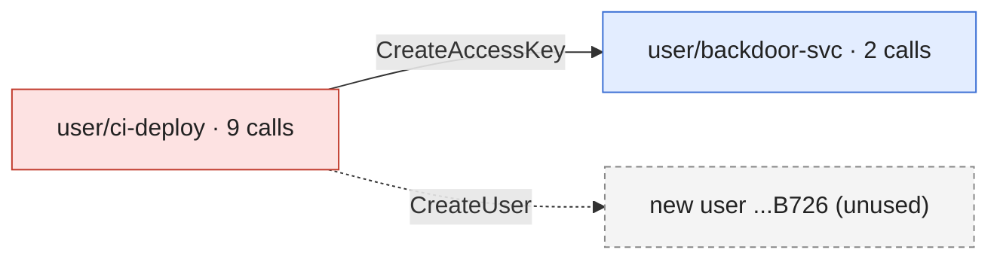

# Incident report

Generated by controlzee 0.1.0.dev0 from scope 167306f72aff700fd0a7f87390d2271ac900ec0e7aeb20745d0d4788e45f0fb3 (timeline 0539fda281ad64d2a6c21e477e6a924c9c9ac278f64ce7818d79067d05823b00, plan 1eb72af6d200472c2f6108aa10ef44d0c553c5e14837e852a6ea4f91f387038e). Everything here is derived from that scope.json; regenerate it rather than editing it.

**Jump to:** [Summary](#summary) · [How the attacker moved](#how-the-attacker-moved) · [Identities](#identities) · [What the logs cannot show](#what-the-logs-cannot-show) · [Timeline](#timeline) · [Exposure](#exposure) · [Response plan](#response-plan) · [Appendix](#appendix)

> **At a glance.** 11 events by 2 identities over 10 minutes, in account 111122223333.
>
> - **Full administrative access was granted**: assume anything in the account(s) could be read or changed.
> - Tactics: persistence ×2 · privilege-escalation ×1 · discovery ×7.
>
> **Do first** (2 containment steps): A01 deactivate an access key the attacker used, A02 deactivate an access key the attacker used.
> Of 6 plan steps, 4 can be carried out by `controlzee respond`; the rest are for a person.

## Summary

- **11 events** in scope (11 strong, 0 weak), from 2026-10-20T14:30:00Z to 2026-10-20T14:40:00Z; 1 of them failed.
- **2 identities** acted for the attacker: user/ci-deploy, user/backdoor-svc.
- **2 credentials or principals** were created or obtained by the attacker and followed; 2 events were found only that way.
- **Tactics:** persistence (2), privilege-escalation (1), discovery (7).
- **Accounts:** 111122223333.
- **Full administrative access was granted.**

## How the attacker moved

Each arrow is a credential or principal one identity created or obtained for another, labelled with the call that issued it. Red: matched an indicator. Blue: found only by following the attacker. Dashed: handed over but never used in these logs.



## Identities

Open one to see who it is, how it came about (the call that created or handed it over, with the parameters that were logged) and what it did. Secrets are never shown, and environment variables show their names only.

<details>
<summary><b>user/ci-deploy</b> · 9 calls · matched an indicator</summary>

| Who it is | Detail |
|---|---|
| ARN | arn:aws:iam::111122223333:user/ci-deploy |
| Account | 111122223333 |
| Access keys | AKIAIOSFODNN7LEAKED |
| Source addresses | 198.51.100.77 |
| User agents | python-requests/2.31.0 |
| First seen | 2026-10-20T14:30:00Z |
| Last seen | 2026-10-20T14:32:20Z |

**Matched** the indicators `attacker\_ip`, `leaked\_key`.

**What it did** (9 calls)

| Time | Call | Target | Result | Parameters (writes) |
|---|---|---|---|---|
| 2026-10-20T14:30:00Z | sts:GetCallerIdentity |  | ok |  |
| 2026-10-20T14:30:10Z | iam:ListUsers |  | ok |  |
| 2026-10-20T14:30:20Z | iam:ListRoles |  | ok |  |
| 2026-10-20T14:30:30Z | s3:ListBuckets |  | ok |  |
| 2026-10-20T14:30:40Z | ec2:DescribeInstances |  | ok |  |
| 2026-10-20T14:30:55Z | iam:GetAccountAuthorizationDetails |  | AccessDenied |  |
| 2026-10-20T14:32:00Z | iam:CreateUser | user backdoor-svc | ok | userName=backdoor-svc |
| 2026-10-20T14:32:10Z | iam:AttachUserPolicy | policy arn:aws:iam::aws:policy/AdministratorAccess; user backdoor-svc | ok | policyArn=arn:aws:iam::aws:policy/AdministratorAccess; userName=backdoor-svc |
| 2026-10-20T14:32:20Z | iam:CreateAccessKey | user backdoor-svc | ok | userName=backdoor-svc |


</details>

<details>
<summary><b>user/backdoor-svc</b> · 2 calls · followed · access key ...DOOR</summary>

| Who it is | Detail |
|---|---|
| ARN | arn:aws:iam::111122223333:user/backdoor-svc |
| Account | 111122223333 |
| Access keys | AKIAIOSFODNN7BKDOOR |
| Source addresses | 198.51.100.78 |
| User agents | python-requests/2.31.0 |
| First seen | 2026-10-20T14:39:00Z |
| Last seen | 2026-10-20T14:40:00Z |

**How it came about.** The call `iam:CreateAccessKey`, made by **user/ci-deploy** at 2026-10-20T14:32:20Z from 198.51.100.77.

| Parameter | Value |
|---|---|
| userName | backdoor-svc |

**What it did** (2 calls)

| Time | Call | Target | Result | Parameters (writes) |
|---|---|---|---|---|
| 2026-10-20T14:39:00Z | s3:ListBuckets |  | ok |  |
| 2026-10-20T14:40:00Z | iam:ListUsers |  | ok |  |


</details>

<details>
<summary><b>user ...B726</b> · never used in these logs</summary>

**How it came about.** The call `iam:CreateUser`, made by **user/ci-deploy** at 2026-10-20T14:32:00Z from 198.51.100.77.

| Parameter | Value |
|---|---|
| userName | backdoor-svc |


</details>

## What the logs cannot show

- no data events in the inputs: S3 object reads and writes, Lambda invocations and other data-plane activity are not visible

## Timeline

All times UTC. *Found by*: a seed matched the indicators; *followed* acted as something the attacker obtained.

<details open>
<summary>Every in-scope call, in order (11)</summary>

| Time | Actor | Action | Target | Result | Tactic | Found by |
|---|---|---|---|---|---|---|
| 2026-10-20T14:30:00Z | user/ci-deploy | sts:GetCallerIdentity |  | ok | discovery | seed (strong) |
| 2026-10-20T14:30:10Z | user/ci-deploy | iam:ListUsers |  | ok | discovery | seed (strong) |
| 2026-10-20T14:30:20Z | user/ci-deploy | iam:ListRoles |  | ok | discovery | seed (strong) |
| 2026-10-20T14:30:30Z | user/ci-deploy | s3:ListBuckets |  | ok | discovery | seed (strong) |
| 2026-10-20T14:30:40Z | user/ci-deploy | ec2:DescribeInstances |  | ok | discovery | seed (strong) |
| 2026-10-20T14:30:55Z | user/ci-deploy | iam:GetAccountAuthorizationDetails |  | AccessDenied | discovery | seed (strong) |
| 2026-10-20T14:32:00Z | user/ci-deploy | iam:CreateUser | user backdoor-svc | ok | persistence | seed (strong) |
| 2026-10-20T14:32:10Z | user/ci-deploy | iam:AttachUserPolicy | policy arn:aws:iam::aws:policy/AdministratorAccess; user backdoor-svc | ok | privilege-escalation | seed (strong) |
| 2026-10-20T14:32:20Z | user/ci-deploy | iam:CreateAccessKey | user backdoor-svc | ok | persistence | seed (strong) |
| 2026-10-20T14:39:00Z | user/backdoor-svc | s3:ListBuckets |  | ok | discovery | followed (strong) |
| 2026-10-20T14:40:00Z | user/backdoor-svc | iam:ListUsers |  | ok | discovery | followed (strong) |

</details>

## Exposure

- full administrative access was granted: assume the attacker could read or change anything in the affected account\(s\) from that moment, including what the logs do not show
- the inputs have no data events, so object-level S3 access \(and similar\) cannot be listed here

<details open>
<summary>Permission changes (1)</summary>

| Time | Change | Principal | Policy | Full control | Result |
|---|---|---|---|---|---|
| 2026-10-20T14:32:10Z | iam:AttachUserPolicy | user backdoor-svc | arn:aws:iam::aws:policy/AdministratorAccess | **yes** | ok |

</details>

<details open>
<summary>Resources touched (2)</summary>

| Service | Type | Name | Access | Calls | Refused | Actions |
|---|---|---|---|---|---|---|
| iam | policy | arn:aws:iam::aws:policy/AdministratorAccess | write | 1 | 0 | iam:AttachUserPolicy |
| iam | user | backdoor-svc | write | 3 | 0 | iam:AttachUserPolicy, iam:CreateAccessKey, iam:CreateUser |

</details>


## Response plan

- steps with operations can be carried out by \`controlzee respond\` after a dry run and your approval; the others are for a person. Either way, review each one first
- work through the phases in order; within contain, act quickly, since the attacker may notice

### Contain

- [ ] **A01. Deactivate an access key the attacker used**: access key AKIAIOSFODNN7BKDOOR of user backdoor-svc \(account 111122223333\)

  2 in-scope call\(s\) were made with it. *(`controlzee respond` can do this)*

  <details>
  <summary>1 command · evidence from 2 calls</summary>

  ```sh
  aws iam update-access-key --user-name backdoor-svc --access-key-id AKIAIOSFODNN7BKDOOR --status Inactive
  ```

  Evidence, the calls behind this step:

  | When (UTC) | Who | Call | Target | Result | Event |
  |---|---|---|---|---|---|
  | 2026-10-20 14:39:00Z | user/backdoor-svc | s3:ListBuckets |  | ok | `ea972266` |
  | 2026-10-20 14:40:00Z | user/backdoor-svc | iam:ListUsers |  | ok | `1e53ffdd` |

  <details>
  <summary>Full event IDs, in the order of the calls above (to copy)</summary>

  ```
  ea972266-d206-5a49-9154-6b3c92801147
  1e53ffdd-8f58-549b-a23f-5584b5fdb45b
  ```

  </details>


  </details>


- [ ] **A02. Deactivate an access key the attacker used**: access key AKIAIOSFODNN7LEAKED of user ci-deploy \(account 111122223333\)

  9 in-scope call\(s\) were made with it. *(`controlzee respond` can do this)*

  Caution: the key's legitimate owner will stop working until it has a replacement \(see the recover steps\).

  <details>
  <summary>1 command · evidence from 9 calls</summary>

  ```sh
  aws iam update-access-key --user-name ci-deploy --access-key-id AKIAIOSFODNN7LEAKED --status Inactive
  ```

  Evidence, the calls behind this step:

  | When (UTC) | Who | Call | Target | Result | Event |
  |---|---|---|---|---|---|
  | 2026-10-20 14:30:00Z | user/ci-deploy | sts:GetCallerIdentity |  | ok | `d554bd6b` |
  | 2026-10-20 14:30:10Z | user/ci-deploy | iam:ListUsers |  | ok | `b2177994` |
  | 2026-10-20 14:30:20Z | user/ci-deploy | iam:ListRoles |  | ok | `2ffe710f` |
  | 2026-10-20 14:30:30Z | user/ci-deploy | s3:ListBuckets |  | ok | `50ee173c` |
  | 2026-10-20 14:30:40Z | user/ci-deploy | ec2:DescribeInstances |  | ok | `cb96022f` |
  | 2026-10-20 14:30:55Z | user/ci-deploy | iam:GetAccountAuthorizationDetails |  | AccessDenied | `94d6ce92` |
  | 2026-10-20 14:32:00Z | user/ci-deploy | iam:CreateUser | user backdoor-svc | ok | `ba5efc04` |
  | 2026-10-20 14:32:10Z | user/ci-deploy | iam:AttachUserPolicy | policy arn:aws:iam::aws:policy/AdministratorAccess; user backdoor-svc | ok | `2d59f198` |
  | 2026-10-20 14:32:20Z | user/ci-deploy | iam:CreateAccessKey | user backdoor-svc | ok | `9c765f05` |

  <details>
  <summary>Full event IDs, in the order of the calls above (to copy)</summary>

  ```
  d554bd6b-07d7-5564-b3ed-5c98efd37228
  b2177994-d66c-53bd-8801-5261f0f910a8
  2ffe710f-fbb1-5679-86f8-d41da46a5f2c
  50ee173c-5c13-5689-97cd-ef168207f84c
  cb96022f-25c2-56a3-ab3f-bf725e6fd694
  94d6ce92-a4b5-5017-b554-c200a68a9aa4
  ba5efc04-26a3-539d-90ad-b357e29515e5
  2d59f198-929c-5fd6-93e2-4b2dbc3e31ac
  9c765f05-4203-5522-a74d-58c985b1a06a
  ```

  </details>


  </details>


### Investigate

- [ ] **A03. Look for object-level access elsewhere**: S3 and other data-plane activity

  the inputs have no data events, so reads of objects, secrets in Lambda and the like are invisible here. *(manual)*

  Caution: sources: S3 server access logs, CloudTrail data events on another trail, VPC flow logs.

### Eradicate

- [ ] **A04. Undo a permission change**: user backdoor-svc

  iam:AttachUserPolicy by an in-scope call \(arn:aws:iam::aws:policy/AdministratorAccess\). *(`controlzee respond` can do this)*

  <details>
  <summary>1 command · evidence from 1 call</summary>

  ```sh
  aws iam detach-user-policy --user-name backdoor-svc --policy-arn arn:aws:iam::aws:policy/AdministratorAccess
  ```

  Evidence, the calls behind this step:

  | When (UTC) | Who | Call | Target | Result | Event |
  |---|---|---|---|---|---|
  | 2026-10-20 14:32:10Z | user/ci-deploy | iam:AttachUserPolicy | policy arn:aws:iam::aws:policy/AdministratorAccess; user backdoor-svc | ok | `2d59f198` |

  <details>
  <summary>Full event IDs, in the order of the calls above (to copy)</summary>

  ```
  2d59f198-929c-5fd6-93e2-4b2dbc3e31ac
  ```

  </details>


  </details>


- [ ] **A05. Delete a user the attacker created**: user backdoor-svc

  created by an in-scope call. *(`controlzee respond` can do this, with --allow-disruptive)*

  Caution: removes its keys, password, policies, groups and MFA devices first; respond does this, by hand repeat each list-then-delete pair until the lists are empty.

  <details>
  <summary>10 commands · evidence from 1 call</summary>

  ```sh
  aws iam list-access-keys --user-name backdoor-svc
  aws iam delete-access-key --user-name backdoor-svc --access-key-id EACH_KEY_FROM_ABOVE
  aws iam delete-login-profile --user-name backdoor-svc
  aws iam list-attached-user-policies --user-name backdoor-svc
  aws iam detach-user-policy --user-name backdoor-svc --policy-arn EACH_POLICY_FROM_ABOVE
  aws iam list-user-policies --user-name backdoor-svc
  aws iam delete-user-policy --user-name backdoor-svc --policy-name EACH_POLICY_FROM_ABOVE
  aws iam list-groups-for-user --user-name backdoor-svc
  aws iam remove-user-from-group --user-name backdoor-svc --group-name EACH_GROUP_FROM_ABOVE
  aws iam delete-user --user-name backdoor-svc
  ```

  Evidence, the calls behind this step:

  | When (UTC) | Who | Call | Target | Result | Event |
  |---|---|---|---|---|---|
  | 2026-10-20 14:32:00Z | user/ci-deploy | iam:CreateUser | user backdoor-svc | ok | `ba5efc04` |

  <details>
  <summary>Full event IDs, in the order of the calls above (to copy)</summary>

  ```
  ba5efc04-26a3-539d-90ad-b357e29515e5
  ```

  </details>


  </details>


### Recover

- [ ] **A06. Give the key's owner a new key, then delete the old one**: user ci-deploy, replacing AKIAIOSFODNN7LEAKED

  its key was deactivated in the contain steps. *(manual)*

  Caution: the new secret is shown once: create it where the owner's secret store can take it, and find out how the old one leaked.

  <details>
  <summary>2 commands · evidence from 9 calls</summary>

  ```sh
  aws iam create-access-key --user-name ci-deploy
  aws iam delete-access-key --user-name ci-deploy --access-key-id AKIAIOSFODNN7LEAKED
  ```

  Evidence, the calls behind this step:

  | When (UTC) | Who | Call | Target | Result | Event |
  |---|---|---|---|---|---|
  | 2026-10-20 14:30:00Z | user/ci-deploy | sts:GetCallerIdentity |  | ok | `d554bd6b` |
  | 2026-10-20 14:30:10Z | user/ci-deploy | iam:ListUsers |  | ok | `b2177994` |
  | 2026-10-20 14:30:20Z | user/ci-deploy | iam:ListRoles |  | ok | `2ffe710f` |
  | 2026-10-20 14:30:30Z | user/ci-deploy | s3:ListBuckets |  | ok | `50ee173c` |
  | 2026-10-20 14:30:40Z | user/ci-deploy | ec2:DescribeInstances |  | ok | `cb96022f` |
  | 2026-10-20 14:30:55Z | user/ci-deploy | iam:GetAccountAuthorizationDetails |  | AccessDenied | `94d6ce92` |
  | 2026-10-20 14:32:00Z | user/ci-deploy | iam:CreateUser | user backdoor-svc | ok | `ba5efc04` |
  | 2026-10-20 14:32:10Z | user/ci-deploy | iam:AttachUserPolicy | policy arn:aws:iam::aws:policy/AdministratorAccess; user backdoor-svc | ok | `2d59f198` |
  | 2026-10-20 14:32:20Z | user/ci-deploy | iam:CreateAccessKey | user backdoor-svc | ok | `9c765f05` |

  <details>
  <summary>Full event IDs, in the order of the calls above (to copy)</summary>

  ```
  d554bd6b-07d7-5564-b3ed-5c98efd37228
  b2177994-d66c-53bd-8801-5261f0f910a8
  2ffe710f-fbb1-5679-86f8-d41da46a5f2c
  50ee173c-5c13-5689-97cd-ef168207f84c
  cb96022f-25c2-56a3-ab3f-bf725e6fd694
  94d6ce92-a4b5-5017-b554-c200a68a9aa4
  ba5efc04-26a3-539d-90ad-b357e29515e5
  2d59f198-929c-5fd6-93e2-4b2dbc3e31ac
  9c765f05-4203-5522-a74d-58c985b1a06a
  ```

  </details>


  </details>


## Appendix

<details>
<summary>Indicators, followed identities and inputs</summary>

Indicators:

| Name | Kind | Value | Match |
|---|---|---|---|
| attacker\_ip | source_ip | 198.51.100.77 | exact |
| leaked\_key | access_key_id | AKIAIOSFODNN7LEAKED | exact |

Expression: leaked\_key AND attacker\_ip

Followed identities:

| Kind | Value | Issued by | At | Events | Confidence |
|---|---|---|---|---|---|
| principal_id | AIDAE18185DBD523AB726 | iam:CreateUser | 2026-10-20T14:32:00Z | 2 | strong |
| access_key_id | AKIAIOSFODNN7BKDOOR | iam:CreateAccessKey | 2026-10-20T14:32:20Z | 2 | strong |

Inputs: 34 events from 4 files (0 unreadable, 0 skipped), 2026-10-20T08:00:00Z to 2026-10-20T23:05:00Z; accounts 111122223333; manifest sha256 1b0363198d1a251b0a8164bbf19ca83e2121f2b0c09103a5c6a0f0ae81d44e6c.

</details>
