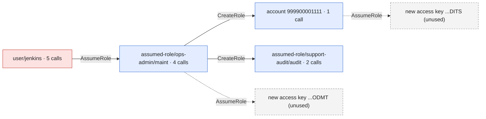

# Incident report

Generated by controlzee 0.1.0.dev0 from scope 4fa1c19c69fe32f1912d9c38ab3917e2aaa5c8c4dcb7384d930a66a9fbbbd6e4 (timeline 4ccd2319927e2d578a2f62180aaf79e07f6a18796600418fd4e52582279643f3, plan 4b68ac9534068f4f6656e0b8639ac26c27d9782d64b61240b2871207f394fabf). Everything here is derived from that scope.json; regenerate it rather than editing it.

**Jump to:** [Summary](#summary) · [How the attacker moved](#how-the-attacker-moved) · [Identities](#identities) · [What the logs cannot show](#what-the-logs-cannot-show) · [Timeline](#timeline) · [Exposure](#exposure) · [Response plan](#response-plan) · [Appendix](#appendix)

> **At a glance.** 12 events by 4 identities over 182 minutes, in accounts 111122223333, 444455556666.
>
> - **1 account reached without logs**: what happened there is unknown.
> - Tactics: persistence ×1 · privilege-escalation ×1 · credential-access ×1 · discovery ×6 · lateral-movement ×3.
>
> **Do first** (4 containment steps): A01 deactivate an access key the attacker used, A02 revoke the user's temporary credentials, A03 revoke the role's active sessions, and 1 more.
> Of 11 plan steps, 8 can be carried out by `controlzee respond`; the rest are for a person.

## Summary

- **12 events** in scope (12 strong, 0 weak), from 2026-10-20T10:00:00Z to 2026-10-20T13:02:00Z; 0 of them failed.
- **4 identities** acted for the attacker: user/jenkins, assumed-role/ops-admin/maint, account 999900001111, assumed-role/support-audit/audit.
- **5 credentials or principals** were created or obtained by the attacker and followed; 8 events were found only that way.
- **Tactics:** persistence (1), privilege-escalation (1), credential-access (1), discovery (6), lateral-movement (3).
- **Accounts:** 111122223333, 444455556666.

## How the attacker moved

Each arrow is a credential or principal one identity created or obtained for another, labelled with the call that issued it. Red: matched an indicator. Blue: found only by following the attacker. Dashed: handed over but never used in these logs.



## Identities

Open one to see who it is, how it came about (the call that created or handed it over, with the parameters that were logged) and what it did. Secrets are never shown, and environment variables show their names only.

<details>
<summary><b>user/jenkins</b> · 5 calls · matched an indicator · access key ...KTOK</summary>

| Who it is | Detail |
|---|---|
| ARN | arn:aws:iam::111122223333:user/jenkins |
| Account | 111122223333 |
| Access keys | AKIAIOSFODNN7LEAKED, ASIAIOSFODNN7JNKTOK |
| Source addresses | 198.51.100.77, 198.51.100.78 |
| User agents | python-requests/2.31.0 |
| First seen | 2026-10-20T10:00:00Z |
| Last seen | 2026-10-20T10:20:00Z |

**Matched** the indicator `leaked\_key`.

**How it came about.** The call `sts:GetSessionToken`, made by **user/jenkins** at 2026-10-20T10:05:00Z from 198.51.100.77.

| Parameter | Value |
|---|---|
| durationSeconds | 43200 |

**What it did** (5 calls)

| Time | Call | Target | Result | Parameters (writes) |
|---|---|---|---|---|
| 2026-10-20T10:00:00Z | sts:GetCallerIdentity |  | ok |  |
| 2026-10-20T10:00:20Z | iam:ListRoles |  | ok |  |
| 2026-10-20T10:01:00Z | sts:AssumeRole | role arn:aws:iam::111122223333:role/ops-admin | ok | roleArn=arn:aws:iam::111122223333:role/ops-admin; roleSessionName=maint |
| 2026-10-20T10:05:00Z | sts:GetSessionToken |  | ok |  |
| 2026-10-20T10:20:00Z | ec2:DescribeInstances |  | ok |  |


</details>

<details>
<summary><b>assumed-role/ops-admin/maint</b> · 4 calls · followed · access key ...SMNT</summary>

| Who it is | Detail |
|---|---|
| ARN | arn:aws:sts::111122223333:assumed-role/ops-admin/maint |
| Account | 111122223333 |
| Access keys | ASIAIOSFODNN7OPSMNT |
| Source addresses | 198.51.100.77 |
| User agents | python-requests/2.31.0 |
| First seen | 2026-10-20T10:02:00Z |
| Last seen | 2026-10-20T10:04:00Z |

**How it came about.** The call `sts:AssumeRole`, made by **user/jenkins** at 2026-10-20T10:01:00Z from 198.51.100.77.

| Parameter | Value |
|---|---|
| roleArn | arn:aws:iam::111122223333:role/ops-admin |
| roleSessionName | maint |

**What it did** (4 calls)

| Time | Call | Target | Result | Parameters (writes) |
|---|---|---|---|---|
| 2026-10-20T10:02:00Z | s3:ListBuckets |  | ok |  |
| 2026-10-20T10:03:00Z | iam:CreateRole | role support-audit | ok | assumeRolePolicyDocument=Allow sts:AssumeRole by arn:aws:iam::999900001111:root; roleName=support-audit |
| 2026-10-20T10:03:10Z | iam:AttachRolePolicy | policy arn:aws:iam::aws:policy/ReadOnlyAccess; role support-audit | ok | policyArn=arn:aws:iam::aws:policy/ReadOnlyAccess; roleName=support-audit |
| 2026-10-20T10:04:00Z | sts:AssumeRole | role arn:aws:iam::444455556666:role/prod-deploy | ok | roleArn=arn:aws:iam::444455556666:role/prod-deploy; roleSessionName=maint |


</details>

<details>
<summary><b>account 999900001111</b> · 1 call · followed · role ...7BFD</summary>

| Who it is | Detail |
|---|---|
| Account | 999900001111 |
| Source addresses | 198.51.100.200 |
| User agents | python-requests/2.31.0 |
| First seen | 2026-10-20T13:00:00Z |
| Last seen | 2026-10-20T13:00:00Z |

**How it came about.** The call `iam:CreateRole`, made by **assumed-role/ops-admin/maint** at 2026-10-20T10:03:00Z from 198.51.100.77.

| Parameter | Value |
|---|---|
| assumeRolePolicyDocument | Allow sts:AssumeRole by arn:aws:iam::999900001111:root |
| roleName | support-audit |

**What it did** (1 call)

| Time | Call | Target | Result | Parameters (writes) |
|---|---|---|---|---|
| 2026-10-20T13:00:00Z | sts:AssumeRole | role arn:aws:iam::111122223333:role/support-audit | ok | roleArn=arn:aws:iam::111122223333:role/support-audit; roleSessionName=audit |


</details>

<details>
<summary><b>assumed-role/support-audit/audit</b> · 2 calls · followed · role ...7BFD</summary>

| Who it is | Detail |
|---|---|
| ARN | arn:aws:sts::111122223333:assumed-role/support-audit/audit |
| Account | 111122223333 |
| Access keys | ASIAIOSFODNN7AUDITS |
| Source addresses | 198.51.100.200 |
| User agents | python-requests/2.31.0 |
| First seen | 2026-10-20T13:01:00Z |
| Last seen | 2026-10-20T13:02:00Z |

**How it came about.** The call `iam:CreateRole`, made by **assumed-role/ops-admin/maint** at 2026-10-20T10:03:00Z from 198.51.100.77.

| Parameter | Value |
|---|---|
| assumeRolePolicyDocument | Allow sts:AssumeRole by arn:aws:iam::999900001111:root |
| roleName | support-audit |

**What it did** (2 calls)

| Time | Call | Target | Result | Parameters (writes) |
|---|---|---|---|---|
| 2026-10-20T13:01:00Z | s3:ListBuckets |  | ok |  |
| 2026-10-20T13:02:00Z | secretsmanager:ListSecrets |  | ok |  |


</details>

<details>
<summary><b>access key ...ODMT</b> · never used in these logs</summary>

**How it came about.** The call `sts:AssumeRole`, made by **assumed-role/ops-admin/maint** at 2026-10-20T10:04:00Z from 198.51.100.77.

| Parameter | Value |
|---|---|
| roleArn | arn:aws:iam::444455556666:role/prod-deploy |
| roleSessionName | maint |


</details>

<details>
<summary><b>access key ...DITS</b> · never used in these logs</summary>

**How it came about.** The call `sts:AssumeRole`, made by **account 999900001111** at 2026-10-20T13:00:00Z from 198.51.100.200.

| Parameter | Value |
|---|---|
| roleArn | arn:aws:iam::111122223333:role/support-audit |
| roleSessionName | audit |


</details>

## What the logs cannot show

- no data events in the inputs: S3 object reads and writes, Lambda invocations and other data-plane activity are not visible
- in-scope activity assumed roles in 1 account\(s\) with no logs in the inputs: 444455556666

## Timeline

All times UTC. *Found by*: a seed matched the indicators; *followed* acted as something the attacker obtained.

<details open>
<summary>Every in-scope call, in order (12)</summary>

| Time | Actor | Action | Target | Result | Tactic | Found by |
|---|---|---|---|---|---|---|
| 2026-10-20T10:00:00Z | user/jenkins | sts:GetCallerIdentity |  | ok | discovery | seed (strong) |
| 2026-10-20T10:00:20Z | user/jenkins | iam:ListRoles |  | ok | discovery | seed (strong) |
| 2026-10-20T10:01:00Z | user/jenkins | sts:AssumeRole | role arn:aws:iam::111122223333:role/ops-admin | ok | lateral-movement | seed (strong) |
| 2026-10-20T10:02:00Z | assumed-role/ops-admin/maint | s3:ListBuckets |  | ok | discovery | followed (strong) |
| 2026-10-20T10:03:00Z | assumed-role/ops-admin/maint | iam:CreateRole | role support-audit | ok | persistence | followed (strong) |
| 2026-10-20T10:03:10Z | assumed-role/ops-admin/maint | iam:AttachRolePolicy | policy arn:aws:iam::aws:policy/ReadOnlyAccess; role support-audit | ok | privilege-escalation | followed (strong) |
| 2026-10-20T10:04:00Z | assumed-role/ops-admin/maint | sts:AssumeRole | role arn:aws:iam::444455556666:role/prod-deploy | ok | lateral-movement | followed (strong) |
| 2026-10-20T10:05:00Z | user/jenkins | sts:GetSessionToken |  | ok | credential-access | seed (strong) |
| 2026-10-20T10:20:00Z | user/jenkins | ec2:DescribeInstances |  | ok | discovery | followed (strong) |
| 2026-10-20T13:00:00Z | account 999900001111 | sts:AssumeRole | role arn:aws:iam::111122223333:role/support-audit | ok | lateral-movement | followed (strong) |
| 2026-10-20T13:01:00Z | assumed-role/support-audit/audit | s3:ListBuckets |  | ok | discovery | followed (strong) |
| 2026-10-20T13:02:00Z | assumed-role/support-audit/audit | secretsmanager:ListSecrets |  | ok | discovery | followed (strong) |

</details>

## Exposure

- the inputs have no data events, so object-level S3 access \(and similar\) cannot be listed here
- activity reached account\(s\) with no logs in the inputs; exposure there is unknown

<details open>
<summary>Permission changes (1)</summary>

| Time | Change | Principal | Policy | Full control | Result |
|---|---|---|---|---|---|
| 2026-10-20T10:03:10Z | iam:AttachRolePolicy | role support-audit | arn:aws:iam::aws:policy/ReadOnlyAccess | no | ok |

</details>

<details open>
<summary>Resources touched (5)</summary>

| Service | Type | Name | Access | Calls | Refused | Actions |
|---|---|---|---|---|---|---|
| iam | policy | arn:aws:iam::aws:policy/ReadOnlyAccess | write | 1 | 0 | iam:AttachRolePolicy |
| iam | role | support-audit | write | 2 | 0 | iam:AttachRolePolicy, iam:CreateRole |
| sts | role | arn:aws:iam::111122223333:role/ops-admin | assume | 1 | 0 | sts:AssumeRole |
| sts | role | arn:aws:iam::111122223333:role/support-audit | assume | 1 | 0 | sts:AssumeRole |
| sts | role | arn:aws:iam::444455556666:role/prod-deploy | assume | 1 | 0 | sts:AssumeRole |

</details>


## Response plan

- steps with operations can be carried out by \`controlzee respond\` after a dry run and your approval; the others are for a person. Either way, review each one first
- work through the phases in order; within contain, act quickly, since the attacker may notice

### Contain

- [ ] **A01. Deactivate an access key the attacker used**: access key AKIAIOSFODNN7LEAKED of user jenkins \(account 111122223333\)

  4 in-scope call\(s\) were made with it. *(`controlzee respond` can do this)*

  Caution: the key's legitimate owner will stop working until it has a replacement \(see the recover steps\).

  <details>
  <summary>1 command · 4 events of evidence</summary>

  ```sh
  aws iam update-access-key --user-name jenkins --access-key-id AKIAIOSFODNN7LEAKED --status Inactive
  ```

  Evidence: 79b57279-7f3c-5b8a-b198-3b0b181b9d46, 8bb4cd19-45aa-5db0-ae36-93addf041786, d554bd6b-07d7-5564-b3ed-5c98efd37228, 94d6ce92-a4b5-5017-b554-c200a68a9aa4

  </details>


- [ ] **A02. Revoke the user's temporary credentials**: session tokens of user jenkins \(account 111122223333\)

  in-scope calls used temporary credentials of this user \(GetSessionToken, federation or a console session\); deactivating the user's keys does not end them. *(`controlzee respond` can do this)*

  Caution: denies everything to credentials issued before now; remove the policy once the incident is over.

  <details>
  <summary>1 command · 1 event of evidence</summary>

  ```sh
  aws iam put-user-policy --user-name jenkins --policy-name controlzee-revoke-older-sessions --policy-document '{"Version":"2012-10-17","Statement":[{"Effect":"Deny","Action":"*","Resource":"*","Condition":{"DateLessThan":{"aws:TokenIssueTime":"'"$(date -u +%Y-%m-%dT%H:%M:%SZ)"'"}}}]}'
  ```

  Evidence: ba5efc04-26a3-539d-90ad-b357e29515e5

  </details>


- [ ] **A03. Revoke the role's active sessions**: role ops-admin \(account 111122223333\)

  4 in-scope call\(s\) were made with sessions of this role. *(`controlzee respond` can do this)*

  Caution: this also ends legitimate sessions of the role; they can assume it again.

  <details>
  <summary>1 command · 4 events of evidence</summary>

  ```sh
  aws iam put-role-policy --role-name ops-admin --policy-name controlzee-revoke-older-sessions --policy-document '{"Version":"2012-10-17","Statement":[{"Effect":"Deny","Action":"*","Resource":"*","Condition":{"DateLessThan":{"aws:TokenIssueTime":"'"$(date -u +%Y-%m-%dT%H:%M:%SZ)"'"}}}]}'
  ```

  Evidence: b2177994-d66c-53bd-8801-5261f0f910a8, 2ffe710f-fbb1-5679-86f8-d41da46a5f2c, 50ee173c-5c13-5689-97cd-ef168207f84c, cb96022f-25c2-56a3-ab3f-bf725e6fd694

  </details>


- [ ] **A04. Revoke the role's active sessions**: role support-audit \(account 111122223333\)

  2 in-scope call\(s\) were made with sessions of this role; the attacker created it. *(`controlzee respond` can do this)*

  <details>
  <summary>1 command · 2 events of evidence</summary>

  ```sh
  aws iam put-role-policy --role-name support-audit --policy-name controlzee-revoke-older-sessions --policy-document '{"Version":"2012-10-17","Statement":[{"Effect":"Deny","Action":"*","Resource":"*","Condition":{"DateLessThan":{"aws:TokenIssueTime":"'"$(date -u +%Y-%m-%dT%H:%M:%SZ)"'"}}}]}'
  ```

  Evidence: ea972266-d206-5a49-9154-6b3c92801147, 1e53ffdd-8f58-549b-a23f-5584b5fdb45b

  </details>


### Investigate

- [ ] **A05. Get the logs of an account the attacker reached**: account 444455556666

  in-scope calls assumed arn:aws:iam::444455556666:role/prod-deploy there, and no logs from it were given. *(manual)*

  Caution: the attacker may hold credentials there that this plan cannot revoke.

  <details>
  <summary>1 command · 1 event of evidence</summary>

  ```sh
  controlzee scope --logs THAT_ACCOUNTS_LOGS --access-key ASIAIOSFODNN7PRODMT -o scope-ASIAIOSFODNN7PRODMT.json
  ```

  Evidence: cb96022f-25c2-56a3-ab3f-bf725e6fd694

  </details>


- [ ] **A06. Look for object-level access elsewhere**: S3 and other data-plane activity

  the inputs have no data events, so reads of objects, secrets in Lambda and the like are invisible here. *(manual)*

  Caution: sources: S3 server access logs, CloudTrail data events on another trail, VPC flow logs.

### Eradicate

- [ ] **A07. Undo a permission change**: role support-audit

  iam:AttachRolePolicy by an in-scope call \(arn:aws:iam::aws:policy/ReadOnlyAccess\). *(`controlzee respond` can do this)*

  <details>
  <summary>1 command · 1 event of evidence</summary>

  ```sh
  aws iam detach-role-policy --role-name support-audit --policy-arn arn:aws:iam::aws:policy/ReadOnlyAccess
  ```

  Evidence: 50ee173c-5c13-5689-97cd-ef168207f84c

  </details>


- [ ] **A08. Delete a role the attacker created**: role support-audit

  created by an in-scope call. *(`controlzee respond` can do this, with --allow-disruptive)*

  <details>
  <summary>7 commands · 1 event of evidence</summary>

  ```sh
  aws iam list-attached-role-policies --role-name support-audit
  aws iam detach-role-policy --role-name support-audit --policy-arn EACH_POLICY_FROM_ABOVE
  aws iam list-role-policies --role-name support-audit
  aws iam delete-role-policy --role-name support-audit --policy-name EACH_POLICY_FROM_ABOVE
  aws iam list-instance-profiles-for-role --role-name support-audit
  aws iam remove-role-from-instance-profile --role-name support-audit --instance-profile-name EACH_PROFILE_FROM_ABOVE
  aws iam delete-role --role-name support-audit
  ```

  Evidence: 2ffe710f-fbb1-5679-86f8-d41da46a5f2c

  </details>


### Recover

- [ ] **A09. Lift the session revocation once the incident is over**: user jenkins

  the deny on older credentials stays until it is removed; legitimate users of this user may need it gone. *(`controlzee respond` can do this, when named with --steps)*

  Caution: only once the attacker's access is gone; respond runs this step only when it is named with --steps.

  <details>
  <summary>1 command · 1 event of evidence</summary>

  ```sh
  aws iam delete-user-policy --user-name jenkins --policy-name controlzee-revoke-older-sessions
  ```

  Evidence: ba5efc04-26a3-539d-90ad-b357e29515e5

  </details>


- [ ] **A10. Lift the session revocation once the incident is over**: role ops-admin

  the deny on older credentials stays until it is removed; legitimate users of this role may need it gone. *(`controlzee respond` can do this, when named with --steps)*

  Caution: only once the attacker's access is gone; respond runs this step only when it is named with --steps.

  <details>
  <summary>1 command · 4 events of evidence</summary>

  ```sh
  aws iam delete-role-policy --role-name ops-admin --policy-name controlzee-revoke-older-sessions
  ```

  Evidence: b2177994-d66c-53bd-8801-5261f0f910a8, 2ffe710f-fbb1-5679-86f8-d41da46a5f2c, 50ee173c-5c13-5689-97cd-ef168207f84c, cb96022f-25c2-56a3-ab3f-bf725e6fd694

  </details>


- [ ] **A11. Give the key's owner a new key, then delete the old one**: user jenkins, replacing AKIAIOSFODNN7LEAKED

  its key was deactivated in the contain steps. *(manual)*

  Caution: the new secret is shown once: create it where the owner's secret store can take it, and find out how the old one leaked.

  <details>
  <summary>2 commands · 4 events of evidence</summary>

  ```sh
  aws iam create-access-key --user-name jenkins
  aws iam delete-access-key --user-name jenkins --access-key-id AKIAIOSFODNN7LEAKED
  ```

  Evidence: 79b57279-7f3c-5b8a-b198-3b0b181b9d46, 8bb4cd19-45aa-5db0-ae36-93addf041786, d554bd6b-07d7-5564-b3ed-5c98efd37228, 94d6ce92-a4b5-5017-b554-c200a68a9aa4

  </details>


## Appendix

<details>
<summary>Indicators, followed identities and inputs</summary>

Indicators:

| Name | Kind | Value | Match |
|---|---|---|---|
| leaked\_key | access_key_id | AKIAIOSFODNN7LEAKED | exact |

Expression: leaked\_key

Followed identities:

| Kind | Value | Issued by | At | Events | Confidence |
|---|---|---|---|---|---|
| access_key_id | ASIAIOSFODNN7OPSMNT | sts:AssumeRole | 2026-10-20T10:01:00Z | 4 | strong |
| role_id | AROA562411BDB29807BFD | iam:CreateRole | 2026-10-20T10:03:00Z | 3 | strong |
| access_key_id | ASIAIOSFODNN7PRODMT | sts:AssumeRole | 2026-10-20T10:04:00Z | 0 | strong |
| access_key_id | ASIAIOSFODNN7JNKTOK | sts:GetSessionToken | 2026-10-20T10:05:00Z | 1 | strong |
| access_key_id | ASIAIOSFODNN7AUDITS | sts:AssumeRole | 2026-10-20T13:00:00Z | 2 | strong |

Inputs: 34 events from 4 files (0 unreadable, 0 skipped), 2026-10-20T08:00:00Z to 2026-10-20T23:05:00Z; accounts 111122223333; manifest sha256 0003caea6caeff962019d3a19ce8d205e753473b3bf637c9f5e14881136ccb81.

</details>
