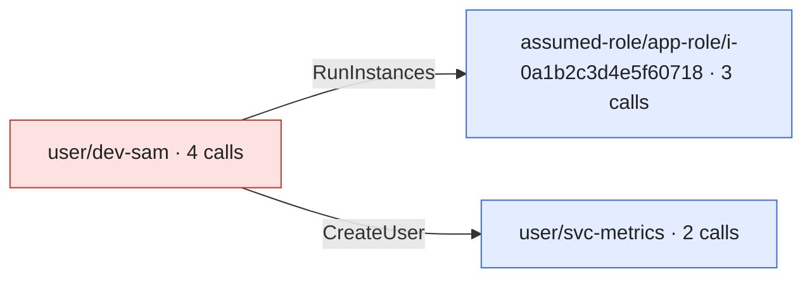

# Incident report

Generated by controlzee 0.1.0.dev0 from scope a0db0c5426321e76c51f845aebb12eda02a90fbd27fa14c31d564151410d72c5 (timeline 6280553fc64e73a081c880fd5ae3bcde7d7fe95783fe28e522025538c566747d, plan 36369e7859785c5598d8f21e8bfef7cb858303bb3f2416535f19de31a7a8ceba). Everything here is derived from that scope.json; regenerate it rather than editing it.

**Jump to:** [Summary](#summary) · [How the attacker moved](#how-the-attacker-moved) · [Identities](#identities) · [What the logs cannot show](#what-the-logs-cannot-show) · [Timeline](#timeline) · [Exposure](#exposure) · [Response plan](#response-plan) · [Appendix](#appendix)

> **At a glance.** 9 events by 3 identities over 181 minutes, in account 111122223333.
>
> - **1 secret or parameter was read**: treat the values as known to the attacker.
> - Tactics: initial-access ×1 · execution ×1 · persistence ×2 · credential-access ×1 · discovery ×4.
>
> **Do first** (6 containment steps): A01 deactivate an access key the attacker used, A02 revoke the user's temporary credentials, A03 revoke the role's active sessions, and 3 more.
> Of 14 plan steps, 11 can be carried out by `controlzee respond`; the rest are for a person.
>
> 9 events are in scope on weak evidence only: confirm them before acting on them.

## Summary

- **9 events** in scope (0 strong, 9 weak), from 2026-10-20T15:05:00Z to 2026-10-20T18:06:00Z; 0 of them failed.
- **3 identities** acted for the attacker: user/dev-sam, assumed-role/app-role/i-0a1b2c3d4e5f60718, user/svc-metrics.
- **2 credentials or principals** were created or obtained by the attacker and followed; 5 events were found only that way.
- **Tactics:** initial-access (1), execution (1), persistence (2), credential-access (1), discovery (4).
- **Accounts:** 111122223333.
- **Credentials read:** secret prod/db.

## How the attacker moved

Each arrow is a credential or principal one identity created or obtained for another, labelled with the call that issued it. Red: matched an indicator. Blue: found only by following the attacker. Dashed: handed over but never used in these logs.



## Identities

Open one to see who it is, how it came about (the call that created or handed it over, with the parameters that were logged) and what it did. Secrets are never shown, and environment variables show their names only.

<details>
<summary><b>user/dev-sam</b> · 4 calls · matched an indicator</summary>

| Who it is | Detail |
|---|---|
| ARN | arn:aws:iam::111122223333:user/dev-sam |
| Account | 111122223333 |
| Access keys | AKIAIOSFODNN7DEVSAM |
| Source addresses | 198.51.100.90 |
| User agents | Boto3/1.34.0 md/Botocore\#1.34.0 ua/2.0 os/linux |
| First seen | 2026-10-20T15:05:00Z |
| Last seen | 2026-10-20T15:07:30Z |

**Matched** the indicator `attacker\_net`.

**What it did** (4 calls)

| Time | Call | Target | Result | Parameters (writes) |
|---|---|---|---|---|
| 2026-10-20T15:05:00Z | ec2:DescribeInstanceTypes |  | ok |  |
| 2026-10-20T15:06:00Z | ec2:RunInstances | instance i-0a1b2c3d4e5f60718 | ok | iamInstanceProfile.name=app-profile; imageId=ami-0abcdef1234567890; instanceType=t3.micro |
| 2026-10-20T15:07:00Z | iam:CreateUser | user svc-metrics | ok | userName=svc-metrics |
| 2026-10-20T15:07:30Z | iam:CreateLoginProfile | user svc-metrics | ok | passwordResetRequired=false; userName=svc-metrics |


</details>

<details>
<summary><b>assumed-role/app-role/i-0a1b2c3d4e5f60718</b> · 3 calls · followed · instance i-0a1b2c3d4e5f60718</summary>

| Who it is | Detail |
|---|---|
| ARN | arn:aws:sts::111122223333:assumed-role/app-role/i-0a1b2c3d4e5f60718 |
| Account | 111122223333 |
| Access keys | ASIAIOSFODNN7INST00 |
| Source addresses | 192.0.2.99 |
| User agents | aws-sdk-go/1.50.0 |
| First seen | 2026-10-20T15:15:00Z |
| Last seen | 2026-10-20T17:05:00Z |

**How it came about.** The call `ec2:RunInstances`, made by **user/dev-sam** at 2026-10-20T15:06:00Z from 198.51.100.90.

| Parameter | Value |
|---|---|
| iamInstanceProfile.name | app-profile |
| imageId | ami-0abcdef1234567890 |
| instanceType | t3.micro |

**What it did** (3 calls)

| Time | Call | Target | Result | Parameters (writes) |
|---|---|---|---|---|
| 2026-10-20T15:15:00Z | s3:ListBuckets |  | ok |  |
| 2026-10-20T15:17:00Z | secretsmanager:ListSecrets |  | ok |  |
| 2026-10-20T17:05:00Z | secretsmanager:GetSecretValue | secret prod/db | ok |  |


</details>

<details>
<summary><b>user/svc-metrics</b> · 2 calls · followed · user ...53B9</summary>

| Who it is | Detail |
|---|---|
| ARN | arn:aws:iam::111122223333:user/svc-metrics |
| Account | 111122223333 |
| Access keys | ASIAIOSFODNN7CONSOL |
| Source addresses | 192.0.2.150 |
| User agents | Mozilla/5.0 \(X11; Linux x86\_64\) |
| First seen | 2026-10-20T18:05:00Z |
| Last seen | 2026-10-20T18:06:00Z |

**How it came about.** The call `iam:CreateUser`, made by **user/dev-sam** at 2026-10-20T15:07:00Z from 198.51.100.90.

| Parameter | Value |
|---|---|
| userName | svc-metrics |

**What it did** (2 calls)

| Time | Call | Target | Result | Parameters (writes) |
|---|---|---|---|---|
| 2026-10-20T18:05:00Z | signin:ConsoleLogin |  | ok |  |
| 2026-10-20T18:06:00Z | iam:ListUsers |  | ok |  |


</details>

## What the logs cannot show

- no data events in the inputs: S3 object reads and writes, Lambda invocations and other data-plane activity are not visible

## Timeline

All times UTC. *Found by*: a seed matched the indicators; *followed* acted as something the attacker obtained.

<details open>
<summary>Every in-scope call, in order (9)</summary>

| Time | Actor | Action | Target | Result | Tactic | Found by |
|---|---|---|---|---|---|---|
| 2026-10-20T15:05:00Z | user/dev-sam | ec2:DescribeInstanceTypes |  | ok | discovery | seed (weak) |
| 2026-10-20T15:06:00Z | user/dev-sam | ec2:RunInstances | instance i-0a1b2c3d4e5f60718 | ok | execution | seed (weak) |
| 2026-10-20T15:07:00Z | user/dev-sam | iam:CreateUser | user svc-metrics | ok | persistence | seed (weak) |
| 2026-10-20T15:07:30Z | user/dev-sam | iam:CreateLoginProfile | user svc-metrics | ok | persistence | seed (weak) |
| 2026-10-20T15:15:00Z | assumed-role/app-role/i-0a1b2c3d4e5f60718 | s3:ListBuckets |  | ok | discovery | followed (weak) |
| 2026-10-20T15:17:00Z | assumed-role/app-role/i-0a1b2c3d4e5f60718 | secretsmanager:ListSecrets |  | ok | discovery | followed (weak) |
| 2026-10-20T17:05:00Z | assumed-role/app-role/i-0a1b2c3d4e5f60718 | secretsmanager:GetSecretValue | secret prod/db | ok | credential-access | followed (weak) |
| 2026-10-20T18:05:00Z | user/svc-metrics | signin:ConsoleLogin |  | ok | initial-access | followed (weak) |
| 2026-10-20T18:06:00Z | user/svc-metrics | iam:ListUsers |  | ok | discovery | followed (weak) |

</details>

## Exposure

- 1 secret\(s\) or parameter\(s\) were read: treat their values as known to the attacker
- the inputs have no data events, so object-level S3 access \(and similar\) cannot be listed here

<details open>
<summary>Resources touched (3)</summary>

| Service | Type | Name | Access | Calls | Refused | Actions |
|---|---|---|---|---|---|---|
| ec2 | instance | i-0a1b2c3d4e5f60718 | write | 1 | 0 | ec2:RunInstances |
| iam | user | svc-metrics | write | 2 | 0 | iam:CreateLoginProfile, iam:CreateUser |
| secretsmanager | secret | prod/db | read | 1 | 0 | secretsmanager:GetSecretValue |

</details>


## Response plan

- steps with operations can be carried out by \`controlzee respond\` after a dry run and your approval; the others are for a person. Either way, review each one first
- work through the phases in order; within contain, act quickly, since the attacker may notice
- steps marked weak rest on weak evidence \(IP, user agent or ARN matches\): confirm them before acting

### Contain

- [ ] **A01. Deactivate an access key the attacker used**: access key AKIAIOSFODNN7DEVSAM of user dev-sam \(account 111122223333\) *(weak evidence: confirm first)*

  4 in-scope call\(s\) were made with it. *(`controlzee respond` can do this)*

  Caution: the key's legitimate owner will stop working until it has a replacement \(see the recover steps\).

  <details>
  <summary>1 command · evidence from 4 calls</summary>

  ```sh
  aws iam update-access-key --user-name dev-sam --access-key-id AKIAIOSFODNN7DEVSAM --status Inactive
  ```

  Evidence, the calls behind this step:

  | When (UTC) | Who | Call | Target | Result | Event |
  |---|---|---|---|---|---|
  | 2026-10-20 15:05:00Z | user/dev-sam | ec2:DescribeInstanceTypes |  | ok | `79b57279` |
  | 2026-10-20 15:06:00Z | user/dev-sam | ec2:RunInstances | instance i-0a1b2c3d4e5f60718 | ok | `8bb4cd19` |
  | 2026-10-20 15:07:00Z | user/dev-sam | iam:CreateUser | user svc-metrics | ok | `d554bd6b` |
  | 2026-10-20 15:07:30Z | user/dev-sam | iam:CreateLoginProfile | user svc-metrics | ok | `b2177994` |

  </details>


- [ ] **A02. Revoke the user's temporary credentials**: session tokens of user svc-metrics \(account 111122223333\) *(weak evidence: confirm first)*

  in-scope calls used temporary credentials of this user \(GetSessionToken, federation or a console session\); deactivating the user's keys does not end them. *(`controlzee respond` can do this)*

  Caution: denies everything to credentials issued before now; remove the policy once the incident is over.

  <details>
  <summary>1 command · evidence from 1 call</summary>

  ```sh
  aws iam put-user-policy --user-name svc-metrics --policy-name controlzee-revoke-older-sessions --policy-document '{"Version":"2012-10-17","Statement":[{"Effect":"Deny","Action":"*","Resource":"*","Condition":{"DateLessThan":{"aws:TokenIssueTime":"'"$(date -u +%Y-%m-%dT%H:%M:%SZ)"'"}}}]}'
  ```

  Evidence, the calls behind this step:

  | When (UTC) | Who | Call | Target | Result | Event |
  |---|---|---|---|---|---|
  | 2026-10-20 18:06:00Z | user/svc-metrics | iam:ListUsers |  | ok | `9c765f05` |

  </details>


- [ ] **A03. Revoke the role's active sessions**: role app-role \(account 111122223333\) *(weak evidence: confirm first)*

  3 in-scope call\(s\) were made with sessions of this role. *(`controlzee respond` can do this)*

  Caution: this also ends legitimate sessions of the role; they can assume it again.

  <details>
  <summary>1 command · evidence from 3 calls</summary>

  ```sh
  aws iam put-role-policy --role-name app-role --policy-name controlzee-revoke-older-sessions --policy-document '{"Version":"2012-10-17","Statement":[{"Effect":"Deny","Action":"*","Resource":"*","Condition":{"DateLessThan":{"aws:TokenIssueTime":"'"$(date -u +%Y-%m-%dT%H:%M:%SZ)"'"}}}]}'
  ```

  Evidence, the calls behind this step:

  | When (UTC) | Who | Call | Target | Result | Event |
  |---|---|---|---|---|---|
  | 2026-10-20 15:15:00Z | assumed-role/app-role/i-0a1b2c3d4e5f60718 | s3:ListBuckets |  | ok | `50ee173c` |
  | 2026-10-20 15:17:00Z | assumed-role/app-role/i-0a1b2c3d4e5f60718 | secretsmanager:ListSecrets |  | ok | `cb96022f` |
  | 2026-10-20 17:05:00Z | assumed-role/app-role/i-0a1b2c3d4e5f60718 | secretsmanager:GetSecretValue | secret prod/db | ok | `94d6ce92` |

  </details>


- [ ] **A04. Remove the console password of a user the attacker created**: user svc-metrics *(weak evidence: confirm first)*

  an in-scope call gave it a console password. *(`controlzee respond` can do this)*

  <details>
  <summary>1 command · evidence from 1 call</summary>

  ```sh
  aws iam delete-login-profile --user-name svc-metrics
  ```

  Evidence, the calls behind this step:

  | When (UTC) | Who | Call | Target | Result | Event |
  |---|---|---|---|---|---|
  | 2026-10-20 15:07:00Z | user/dev-sam | iam:CreateUser | user svc-metrics | ok | `d554bd6b` |

  </details>


- [ ] **A05. Cut an attacker's instance off from its role**: instance i-0a1b2c3d4e5f60718 \(us-east-1\) *(weak evidence: confirm first)*

  launched by an in-scope call with an instance profile; it keeps fetching new role credentials until the profile is removed. *(`controlzee respond` can do this)*

  <details>
  <summary>2 commands · evidence from 1 call</summary>

  ```sh
  aws ec2 describe-iam-instance-profile-associations --region us-east-1 --filters Name=instance-id,Values=i-0a1b2c3d4e5f60718 --query 'IamInstanceProfileAssociations[].AssociationId'
  aws ec2 disassociate-iam-instance-profile --region us-east-1 --association-id ASSOCIATION_ID_FROM_ABOVE
  ```

  Evidence, the calls behind this step:

  | When (UTC) | Who | Call | Target | Result | Event |
  |---|---|---|---|---|---|
  | 2026-10-20 15:06:00Z | user/dev-sam | ec2:RunInstances | instance i-0a1b2c3d4e5f60718 | ok | `8bb4cd19` |

  </details>


- [ ] **A06. Stop an attacker's instance**: instance i-0a1b2c3d4e5f60718 \(us-east-1\) *(weak evidence: confirm first)*

  it may still run the attacker's code. *(`controlzee respond` can do this, with --allow-disruptive)*

  Caution: stopping loses its memory; capture it first if you need it, and snapshot the disks \(see the investigate steps\).

  <details>
  <summary>1 command · evidence from 1 call</summary>

  ```sh
  aws ec2 stop-instances --region us-east-1 --instance-ids i-0a1b2c3d4e5f60718
  ```

  Evidence, the calls behind this step:

  | When (UTC) | Who | Call | Target | Result | Event |
  |---|---|---|---|---|---|
  | 2026-10-20 15:06:00Z | user/dev-sam | ec2:RunInstances | instance i-0a1b2c3d4e5f60718 | ok | `8bb4cd19` |

  </details>


### Investigate

- [ ] **A07. Look for object-level access elsewhere**: S3 and other data-plane activity

  the inputs have no data events, so reads of objects, secrets in Lambda and the like are invisible here. *(manual)*

  Caution: sources: S3 server access logs, CloudTrail data events on another trail, VPC flow logs.

- [ ] **A08. Preserve an attacker's instance for analysis**: instance i-0a1b2c3d4e5f60718 \(us-east-1\) *(weak evidence: confirm first)*

  snapshot its disks before it is terminated. *(`controlzee respond` can do this)*

  <details>
  <summary>2 commands · evidence from 1 call</summary>

  ```sh
  aws ec2 describe-instances --region us-east-1 --instance-ids i-0a1b2c3d4e5f60718 --query 'Reservations[].Instances[].BlockDeviceMappings[].Ebs.VolumeId'
  aws ec2 create-snapshot --region us-east-1 --volume-id VOLUME_ID_FROM_ABOVE --description 'controlzee: evidence from i-0a1b2c3d4e5f60718'
  ```

  Evidence, the calls behind this step:

  | When (UTC) | Who | Call | Target | Result | Event |
  |---|---|---|---|---|---|
  | 2026-10-20 15:06:00Z | user/dev-sam | ec2:RunInstances | instance i-0a1b2c3d4e5f60718 | ok | `8bb4cd19` |

  </details>


### Eradicate

- [ ] **A09. Delete a user the attacker created**: user svc-metrics *(weak evidence: confirm first)*

  created by an in-scope call. *(`controlzee respond` can do this, with --allow-disruptive)*

  Caution: removes its keys, password, policies, groups and MFA devices first; respond does this, by hand repeat each list-then-delete pair until the lists are empty.

  <details>
  <summary>10 commands · evidence from 1 call</summary>

  ```sh
  aws iam list-access-keys --user-name svc-metrics
  aws iam delete-access-key --user-name svc-metrics --access-key-id EACH_KEY_FROM_ABOVE
  aws iam delete-login-profile --user-name svc-metrics
  aws iam list-attached-user-policies --user-name svc-metrics
  aws iam detach-user-policy --user-name svc-metrics --policy-arn EACH_POLICY_FROM_ABOVE
  aws iam list-user-policies --user-name svc-metrics
  aws iam delete-user-policy --user-name svc-metrics --policy-name EACH_POLICY_FROM_ABOVE
  aws iam list-groups-for-user --user-name svc-metrics
  aws iam remove-user-from-group --user-name svc-metrics --group-name EACH_GROUP_FROM_ABOVE
  aws iam delete-user --user-name svc-metrics
  ```

  Evidence, the calls behind this step:

  | When (UTC) | Who | Call | Target | Result | Event |
  |---|---|---|---|---|---|
  | 2026-10-20 15:07:00Z | user/dev-sam | iam:CreateUser | user svc-metrics | ok | `d554bd6b` |

  </details>


- [ ] **A10. Terminate an attacker's instance**: instance i-0a1b2c3d4e5f60718 \(us-east-1\) *(weak evidence: confirm first)*

  launched by an in-scope call. *(`controlzee respond` can do this, with --allow-disruptive)*

  Caution: only after its disks are preserved.

  <details>
  <summary>1 command · evidence from 1 call</summary>

  ```sh
  aws ec2 terminate-instances --region us-east-1 --instance-ids i-0a1b2c3d4e5f60718
  ```

  Evidence, the calls behind this step:

  | When (UTC) | Who | Call | Target | Result | Event |
  |---|---|---|---|---|---|
  | 2026-10-20 15:06:00Z | user/dev-sam | ec2:RunInstances | instance i-0a1b2c3d4e5f60718 | ok | `8bb4cd19` |

  </details>


### Recover

- [ ] **A11. Rotate a secret the attacker read**: secret prod/db *(weak evidence: confirm first)*

  read by an in-scope call. *(manual)*

  Caution: rotation needs a rotation function; otherwise set a new value and update its users.

  <details>
  <summary>1 command · evidence from 1 call</summary>

  ```sh
  aws secretsmanager rotate-secret --region us-east-1 --secret-id prod/db
  ```

  Evidence, the calls behind this step:

  | When (UTC) | Who | Call | Target | Result | Event |
  |---|---|---|---|---|---|
  | 2026-10-20 17:05:00Z | assumed-role/app-role/i-0a1b2c3d4e5f60718 | secretsmanager:GetSecretValue | secret prod/db | ok | `94d6ce92` |

  </details>


- [ ] **A12. Lift the session revocation once the incident is over**: user svc-metrics *(weak evidence: confirm first)*

  the deny on older credentials stays until it is removed; legitimate users of this user may need it gone. *(`controlzee respond` can do this, when named with --steps)*

  Caution: only once the attacker's access is gone; respond runs this step only when it is named with --steps.

  <details>
  <summary>1 command · evidence from 1 call</summary>

  ```sh
  aws iam delete-user-policy --user-name svc-metrics --policy-name controlzee-revoke-older-sessions
  ```

  Evidence, the calls behind this step:

  | When (UTC) | Who | Call | Target | Result | Event |
  |---|---|---|---|---|---|
  | 2026-10-20 18:06:00Z | user/svc-metrics | iam:ListUsers |  | ok | `9c765f05` |

  </details>


- [ ] **A13. Lift the session revocation once the incident is over**: role app-role *(weak evidence: confirm first)*

  the deny on older credentials stays until it is removed; legitimate users of this role may need it gone. *(`controlzee respond` can do this, when named with --steps)*

  Caution: only once the attacker's access is gone; respond runs this step only when it is named with --steps.

  <details>
  <summary>1 command · evidence from 3 calls</summary>

  ```sh
  aws iam delete-role-policy --role-name app-role --policy-name controlzee-revoke-older-sessions
  ```

  Evidence, the calls behind this step:

  | When (UTC) | Who | Call | Target | Result | Event |
  |---|---|---|---|---|---|
  | 2026-10-20 15:15:00Z | assumed-role/app-role/i-0a1b2c3d4e5f60718 | s3:ListBuckets |  | ok | `50ee173c` |
  | 2026-10-20 15:17:00Z | assumed-role/app-role/i-0a1b2c3d4e5f60718 | secretsmanager:ListSecrets |  | ok | `cb96022f` |
  | 2026-10-20 17:05:00Z | assumed-role/app-role/i-0a1b2c3d4e5f60718 | secretsmanager:GetSecretValue | secret prod/db | ok | `94d6ce92` |

  </details>


- [ ] **A14. Give the key's owner a new key, then delete the old one**: user dev-sam, replacing AKIAIOSFODNN7DEVSAM *(weak evidence: confirm first)*

  its key was deactivated in the contain steps. *(manual)*

  Caution: the new secret is shown once: create it where the owner's secret store can take it, and find out how the old one leaked.

  <details>
  <summary>2 commands · evidence from 4 calls</summary>

  ```sh
  aws iam create-access-key --user-name dev-sam
  aws iam delete-access-key --user-name dev-sam --access-key-id AKIAIOSFODNN7DEVSAM
  ```

  Evidence, the calls behind this step:

  | When (UTC) | Who | Call | Target | Result | Event |
  |---|---|---|---|---|---|
  | 2026-10-20 15:05:00Z | user/dev-sam | ec2:DescribeInstanceTypes |  | ok | `79b57279` |
  | 2026-10-20 15:06:00Z | user/dev-sam | ec2:RunInstances | instance i-0a1b2c3d4e5f60718 | ok | `8bb4cd19` |
  | 2026-10-20 15:07:00Z | user/dev-sam | iam:CreateUser | user svc-metrics | ok | `d554bd6b` |
  | 2026-10-20 15:07:30Z | user/dev-sam | iam:CreateLoginProfile | user svc-metrics | ok | `b2177994` |

  </details>


## Appendix

<details>
<summary>Indicators, followed identities and inputs</summary>

Indicators:

| Name | Kind | Value | Match |
|---|---|---|---|
| attacker\_net | source_ip | 198.51.100.0/24 | exact |

Expression: attacker\_net
Window: 2026-10-20T15:00:00Z to 2026-10-20T15:30:00Z

Followed identities:

| Kind | Value | Issued by | At | Events | Confidence |
|---|---|---|---|---|---|
| instance_id | i-0a1b2c3d4e5f60718 | ec2:RunInstances | 2026-10-20T15:06:00Z | 3 | weak |
| principal_id | AIDA0D8A5F8CEBAA453B9 | iam:CreateUser | 2026-10-20T15:07:00Z | 2 | weak |

Inputs: 32 events from 3 files (0 unreadable, 0 skipped), 2026-10-20T08:00:00Z to 2026-10-20T23:05:00Z; accounts 111122223333; manifest sha256 31e0f0fec11d05b970d927acac659efa58f49fb296b8b50ae26db3821f89645e.

</details>
