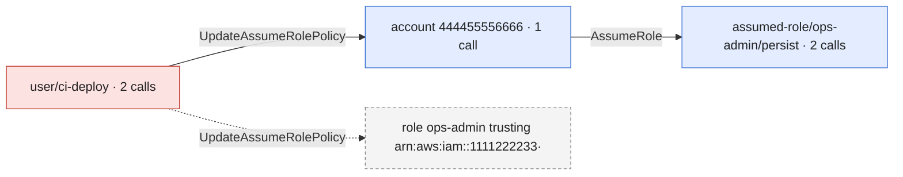

# Incident report

Generated by controlzee 0.1.0.dev0 from scope 60efe7243500687a88fff9f514752bbfb77e205e88ad0ba9aaadffe82dc427ec (timeline a952a757fbd844c31fa8d4e38aae5ddca66be192e88ab272933d19d7c220ca88, plan 95e2eb87c4493efc56c7296f0dd09864e6dda2ef69b2c40c1c1c594920e68deb). Everything here is derived from that scope.json; regenerate it rather than editing it.

**Jump to:** [Summary](#summary) · [How the attacker moved](#how-the-attacker-moved) · [Identities](#identities) · [What the logs cannot show](#what-the-logs-cannot-show) · [Timeline](#timeline) · [Exposure](#exposure) · [Response plan](#response-plan) · [Appendix](#appendix)

> **At a glance.** 5 events by 3 identities over 24 minutes, in account 111122223333.
>
> - **1 secret or parameter was read**: treat the values as known to the attacker.
> - Tactics: persistence ×1 · credential-access ×1 · discovery ×2 · lateral-movement ×1.
>
> **Do first** (2 containment steps): A01 deactivate an access key the attacker used, A02 revoke the role's active sessions.
> Of 7 plan steps, 3 can be carried out by `controlzee respond`; the rest are for a person.

## Summary

- **5 events** in scope (5 strong, 0 weak), from 2026-10-20T12:00:00Z to 2026-10-20T12:24:00Z; 0 of them failed.
- **3 identities** acted for the attacker: user/ci-deploy, account 444455556666, assumed-role/ops-admin/persist.
- **3 credentials or principals** were created or obtained by the attacker and followed; 3 events were found only that way.
- **Tactics:** persistence (1), credential-access (1), discovery (2), lateral-movement (1).
- **Accounts:** 111122223333.
- **Credentials read:** secret prod/db.

## How the attacker moved

Each arrow is a credential or principal one identity created or obtained for another, labelled with the call that issued it. Red: matched an indicator. Blue: found only by following the attacker. Dashed: handed over but never used in these logs.



## Identities

Open one to see who it is, how it came about (the call that created or handed it over, with the parameters that were logged) and what it did. Secrets are never shown, and environment variables show their names only.

<details>
<summary><b>user/ci-deploy</b> · 2 calls · matched an indicator</summary>

| Who it is | Detail |
|---|---|
| ARN | arn:aws:iam::111122223333:user/ci-deploy |
| Account | 111122223333 |
| Access keys | AKIAIOSFODNN7LEAKED |
| Source addresses | 198.51.100.77 |
| User agents | python-requests/2.31.0 |
| First seen | 2026-10-20T12:00:00Z |
| Last seen | 2026-10-20T12:02:00Z |

**Matched** the indicator `leaked\_key`.

**What it did** (2 calls)

| Time | Call | Target | Result | Parameters (writes) |
|---|---|---|---|---|
| 2026-10-20T12:00:00Z | sts:GetCallerIdentity |  | ok |  |
| 2026-10-20T12:02:00Z | iam:UpdateAssumeRolePolicy | role ops-admin | ok | policyDocument=Allow sts:AssumeRole by arn:aws:iam::111122223333:role/deplo; roleName=ops-admin |


</details>

<details>
<summary><b>account 444455556666</b> · 1 call · followed · role ops-admin trusting account:444455556666</summary>

| Who it is | Detail |
|---|---|
| Account | 444455556666 |
| Source addresses | 198.51.100.78 |
| User agents | python-requests/2.31.0 |
| First seen | 2026-10-20T12:20:00Z |
| Last seen | 2026-10-20T12:20:00Z |

**How it came about.** The call `iam:UpdateAssumeRolePolicy`, made by **user/ci-deploy** at 2026-10-20T12:02:00Z from 198.51.100.77.

| Parameter | Value |
|---|---|
| policyDocument | Allow sts:AssumeRole by arn:aws:iam::111122223333:role/deploy-role; Allow sts:AssumeRole by arn:aws:iam::444455556666:root; Allow sts:AssumeRole by ec2.amazonaws.com |
| roleName | ops-admin |

**What it did** (1 call)

| Time | Call | Target | Result | Parameters (writes) |
|---|---|---|---|---|
| 2026-10-20T12:20:00Z | sts:AssumeRole | role arn:aws:iam::111122223333:role/ops-admin | ok | roleArn=arn:aws:iam::111122223333:role/ops-admin; roleSessionName=persist |


</details>

<details>
<summary><b>assumed-role/ops-admin/persist</b> · 2 calls · followed · access key ...T001</summary>

| Who it is | Detail |
|---|---|
| ARN | arn:aws:sts::111122223333:assumed-role/ops-admin/persist |
| Account | 111122223333 |
| Access keys | ASIAIOSFODNN7EXT001 |
| Source addresses | 198.51.100.78 |
| User agents | python-requests/2.31.0 |
| First seen | 2026-10-20T12:22:00Z |
| Last seen | 2026-10-20T12:24:00Z |

**How it came about.** The call `sts:AssumeRole`, made by **account 444455556666** at 2026-10-20T12:20:00Z from 198.51.100.78.

| Parameter | Value |
|---|---|
| roleArn | arn:aws:iam::111122223333:role/ops-admin |
| roleSessionName | persist |

**What it did** (2 calls)

| Time | Call | Target | Result | Parameters (writes) |
|---|---|---|---|---|
| 2026-10-20T12:22:00Z | iam:ListUsers |  | ok |  |
| 2026-10-20T12:24:00Z | secretsmanager:GetSecretValue | secret prod/db | ok |  |


</details>

<details>
<summary><b>role ops-admin trusting arn:aws:iam::111122223333:role/deploy-role</b> · never used in these logs</summary>

**How it came about.** The call `iam:UpdateAssumeRolePolicy`, made by **user/ci-deploy** at 2026-10-20T12:02:00Z from 198.51.100.77.

| Parameter | Value |
|---|---|
| policyDocument | Allow sts:AssumeRole by arn:aws:iam::111122223333:role/deploy-role; Allow sts:AssumeRole by arn:aws:iam::444455556666:root; Allow sts:AssumeRole by ec2.amazonaws.com |
| roleName | ops-admin |


</details>

## What the logs cannot show

- no data events in the inputs: S3 object reads and writes, Lambda invocations and other data-plane activity are not visible

## Timeline

All times UTC. *Found by*: a seed matched the indicators; *followed* acted as something the attacker obtained.

<details open>
<summary>Every in-scope call, in order (5)</summary>

| Time | Actor | Action | Target | Result | Tactic | Found by |
|---|---|---|---|---|---|---|
| 2026-10-20T12:00:00Z | user/ci-deploy | sts:GetCallerIdentity |  | ok | discovery | seed (strong) |
| 2026-10-20T12:02:00Z | user/ci-deploy | iam:UpdateAssumeRolePolicy | role ops-admin | ok | persistence | seed (strong) |
| 2026-10-20T12:20:00Z | account 444455556666 | sts:AssumeRole | role arn:aws:iam::111122223333:role/ops-admin | ok | lateral-movement | followed (strong) |
| 2026-10-20T12:22:00Z | assumed-role/ops-admin/persist | iam:ListUsers |  | ok | discovery | followed (strong) |
| 2026-10-20T12:24:00Z | assumed-role/ops-admin/persist | secretsmanager:GetSecretValue | secret prod/db | ok | credential-access | followed (strong) |

</details>

## Exposure

- 1 secret\(s\) or parameter\(s\) were read: treat their values as known to the attacker
- the inputs have no data events, so object-level S3 access \(and similar\) cannot be listed here
- the trust policy of role ops-admin was changed and names account:444455556666, arn:aws:iam::111122223333:role/deploy-role; the logs hold the new policy and not the old, so which of these were added is not shown

<details open>
<summary>Permission changes (1)</summary>

| Time | Change | Principal | Policy | Full control | Result |
|---|---|---|---|---|---|
| 2026-10-20T12:02:00Z | iam:UpdateAssumeRolePolicy | role ops-admin |  | no | ok |

</details>

<details open>
<summary>Resources touched (3)</summary>

| Service | Type | Name | Access | Calls | Refused | Actions |
|---|---|---|---|---|---|---|
| iam | role | ops-admin | write | 1 | 0 | iam:UpdateAssumeRolePolicy |
| secretsmanager | secret | prod/db | read | 1 | 0 | secretsmanager:GetSecretValue |
| sts | role | arn:aws:iam::111122223333:role/ops-admin | assume | 1 | 0 | sts:AssumeRole |

</details>


## Response plan

- steps with operations can be carried out by \`controlzee respond\` after a dry run and your approval; the others are for a person. Either way, review each one first
- work through the phases in order; within contain, act quickly, since the attacker may notice

### Contain

- [ ] **A01. Deactivate an access key the attacker used**: access key AKIAIOSFODNN7LEAKED of user ci-deploy \(account 111122223333\)

  2 in-scope call\(s\) were made with it. *(`controlzee respond` can do this)*

  Caution: the key's legitimate owner will stop working until it has a replacement \(see the recover steps\).

  <details>
  <summary>1 command · evidence from 2 calls</summary>

  ```sh
  aws iam update-access-key --user-name ci-deploy --access-key-id AKIAIOSFODNN7LEAKED --status Inactive
  ```

  Evidence, the calls behind this step:

  | When (UTC) | Who | Call | Target | Result | Event |
  |---|---|---|---|---|---|
  | 2026-10-20 12:00:00Z | user/ci-deploy | sts:GetCallerIdentity |  | ok | `8bb4cd19` |
  | 2026-10-20 12:02:00Z | user/ci-deploy | iam:UpdateAssumeRolePolicy | role ops-admin | ok | `d554bd6b` |

  <details>
  <summary>Full event IDs, in the order of the calls above (to copy)</summary>

  ```
  8bb4cd19-45aa-5db0-ae36-93addf041786
  d554bd6b-07d7-5564-b3ed-5c98efd37228
  ```

  </details>


  </details>


- [ ] **A02. Revoke the role's active sessions**: role ops-admin \(account 111122223333\)

  2 in-scope call\(s\) were made with sessions of this role. *(`controlzee respond` can do this)*

  Caution: this also ends legitimate sessions of the role; they can assume it again.

  <details>
  <summary>1 command · evidence from 2 calls</summary>

  ```sh
  aws iam put-role-policy --role-name ops-admin --policy-name controlzee-revoke-older-sessions --policy-document '{"Version":"2012-10-17","Statement":[{"Effect":"Deny","Action":"*","Resource":"*","Condition":{"DateLessThan":{"aws:TokenIssueTime":"'"$(date -u +%Y-%m-%dT%H:%M:%SZ)"'"}}}]}'
  ```

  Evidence, the calls behind this step:

  | When (UTC) | Who | Call | Target | Result | Event |
  |---|---|---|---|---|---|
  | 2026-10-20 12:22:00Z | assumed-role/ops-admin/persist | iam:ListUsers |  | ok | `2ffe710f` |
  | 2026-10-20 12:24:00Z | assumed-role/ops-admin/persist | secretsmanager:GetSecretValue | secret prod/db | ok | `50ee173c` |

  <details>
  <summary>Full event IDs, in the order of the calls above (to copy)</summary>

  ```
  2ffe710f-fbb1-5679-86f8-d41da46a5f2c
  50ee173c-5c13-5689-97cd-ef168207f84c
  ```

  </details>


  </details>


### Investigate

- [ ] **A03. Look for object-level access elsewhere**: S3 and other data-plane activity

  the inputs have no data events, so reads of objects, secrets in Lambda and the like are invisible here. *(manual)*

  Caution: sources: S3 server access logs, CloudTrail data events on another trail, VPC flow logs.

### Eradicate

- [ ] **A04. Undo a permission change**: role ops-admin

  iam:UpdateAssumeRolePolicy by an in-scope call. *(manual)*

  Caution: restore the role's previous trust policy by hand: the logs show the new one, not the old; the new policy names: account:444455556666, arn:aws:iam::111122223333:role/deploy-role. A call into the role by a principal it names that had not assumed it before the change is followed as the attacker's.

  <details>
  <summary>2 commands · evidence from 1 call</summary>

  ```sh
  aws iam get-role --role-name ops-admin --query Role.AssumeRolePolicyDocument
  aws iam update-assume-role-policy --role-name ops-admin --policy-document file://PREVIOUS_TRUST_POLICY.json
  ```

  Evidence, the calls behind this step:

  | When (UTC) | Who | Call | Target | Result | Event |
  |---|---|---|---|---|---|
  | 2026-10-20 12:02:00Z | user/ci-deploy | iam:UpdateAssumeRolePolicy | role ops-admin | ok | `d554bd6b` |

  <details>
  <summary>Full event IDs, in the order of the calls above (to copy)</summary>

  ```
  d554bd6b-07d7-5564-b3ed-5c98efd37228
  ```

  </details>


  </details>


### Recover

- [ ] **A05. Rotate a secret the attacker read**: secret prod/db

  read by an in-scope call. *(manual)*

  Caution: rotation needs a rotation function; otherwise set a new value and update its users.

  <details>
  <summary>1 command · evidence from 1 call</summary>

  ```sh
  aws secretsmanager rotate-secret --region us-east-1 --secret-id prod/db
  ```

  Evidence, the calls behind this step:

  | When (UTC) | Who | Call | Target | Result | Event |
  |---|---|---|---|---|---|
  | 2026-10-20 12:24:00Z | assumed-role/ops-admin/persist | secretsmanager:GetSecretValue | secret prod/db | ok | `50ee173c` |

  <details>
  <summary>Full event IDs, in the order of the calls above (to copy)</summary>

  ```
  50ee173c-5c13-5689-97cd-ef168207f84c
  ```

  </details>


  </details>


- [ ] **A06. Lift the session revocation once the incident is over**: role ops-admin

  the deny on older credentials stays until it is removed; legitimate users of this role may need it gone. *(`controlzee respond` can do this, when named with --steps)*

  Caution: only once the attacker's access is gone; respond runs this step only when it is named with --steps.

  <details>
  <summary>1 command · evidence from 2 calls</summary>

  ```sh
  aws iam delete-role-policy --role-name ops-admin --policy-name controlzee-revoke-older-sessions
  ```

  Evidence, the calls behind this step:

  | When (UTC) | Who | Call | Target | Result | Event |
  |---|---|---|---|---|---|
  | 2026-10-20 12:22:00Z | assumed-role/ops-admin/persist | iam:ListUsers |  | ok | `2ffe710f` |
  | 2026-10-20 12:24:00Z | assumed-role/ops-admin/persist | secretsmanager:GetSecretValue | secret prod/db | ok | `50ee173c` |

  <details>
  <summary>Full event IDs, in the order of the calls above (to copy)</summary>

  ```
  2ffe710f-fbb1-5679-86f8-d41da46a5f2c
  50ee173c-5c13-5689-97cd-ef168207f84c
  ```

  </details>


  </details>


- [ ] **A07. Give the key's owner a new key, then delete the old one**: user ci-deploy, replacing AKIAIOSFODNN7LEAKED

  its key was deactivated in the contain steps. *(manual)*

  Caution: the new secret is shown once: create it where the owner's secret store can take it, and find out how the old one leaked.

  <details>
  <summary>2 commands · evidence from 2 calls</summary>

  ```sh
  aws iam create-access-key --user-name ci-deploy
  aws iam delete-access-key --user-name ci-deploy --access-key-id AKIAIOSFODNN7LEAKED
  ```

  Evidence, the calls behind this step:

  | When (UTC) | Who | Call | Target | Result | Event |
  |---|---|---|---|---|---|
  | 2026-10-20 12:00:00Z | user/ci-deploy | sts:GetCallerIdentity |  | ok | `8bb4cd19` |
  | 2026-10-20 12:02:00Z | user/ci-deploy | iam:UpdateAssumeRolePolicy | role ops-admin | ok | `d554bd6b` |

  <details>
  <summary>Full event IDs, in the order of the calls above (to copy)</summary>

  ```
  8bb4cd19-45aa-5db0-ae36-93addf041786
  d554bd6b-07d7-5564-b3ed-5c98efd37228
  ```

  </details>


  </details>


## Appendix

<details>
<summary>Indicators, followed identities and inputs</summary>

Indicators:

| Name | Kind | Value | Match |
|---|---|---|---|
| leaked\_key | access_key_id | AKIAIOSFODNN7LEAKED | exact |

Expression: leaked\_key

Followed identities:

| Kind | Value | Issued by | At | Events | Confidence |
|---|---|---|---|---|---|
| trusted_by | ops-admin\|account:444455556666 | iam:UpdateAssumeRolePolicy | 2026-10-20T12:02:00Z | 1 | strong |
| trusted_by | ops-admin\|arn:aws:iam::111122223333:role/deploy-role | iam:UpdateAssumeRolePolicy | 2026-10-20T12:02:00Z | 0 | strong |
| access_key_id | ASIAIOSFODNN7EXT001 | sts:AssumeRole | 2026-10-20T12:20:00Z | 2 | strong |

Inputs: 29 events from 3 files (0 unreadable, 0 skipped), 2026-10-20T08:00:00Z to 2026-10-20T23:05:00Z; accounts 111122223333; manifest sha256 b513a9ab8c408ade80661fe2d1037ec13ccff6bcf9c44b939b5a59cb1731576a.

</details>
