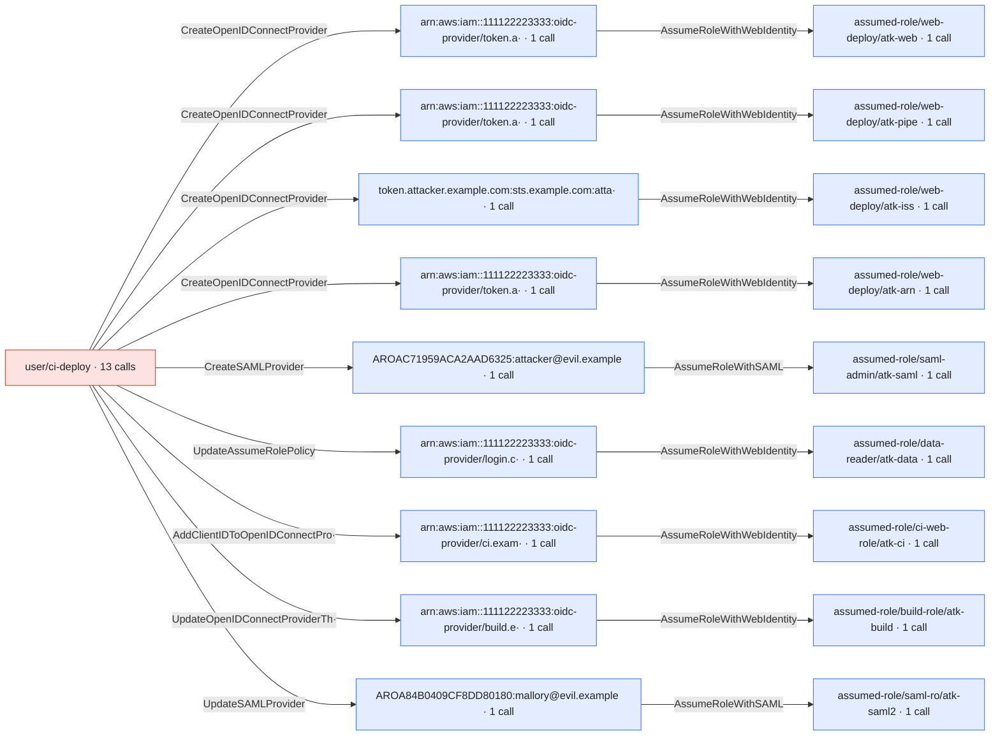

# Incident report

Generated by controlzee 0.1.0.dev0 from scope 7eb292e580ed37c932b8aed5ac28508e624b758b1979215ec630128db8aae17f (timeline 2318fe6d6f2464e17acbdd273f02061e3309c12cd120be5edfb62a3ce37df1a7, plan 6a6657c01764902cabc4fd03bc23c12e3154d79ceef43f74123fcb7c0b739ee2). Everything here is derived from that scope.json; regenerate it rather than editing it.

**Jump to:** [Summary](#summary) · [How the attacker moved](#how-the-attacker-moved) · [Identities](#identities) · [What the logs cannot show](#what-the-logs-cannot-show) · [Timeline](#timeline) · [Exposure](#exposure) · [Response plan](#response-plan) · [Appendix](#appendix)

> **At a glance.** 31 events by 19 identities over 51 minutes, in account 111122223333.
>
> - **9 secrets or parameters were read**: treat the values as known to the attacker.
> - Tactics: persistence ×1 · credential-access ×9 · discovery ×1 · lateral-movement ×9 · other ×10.
>
> **Do first** (7 containment steps): A01 deactivate an access key the attacker used, A02 revoke the role's active sessions, A03 revoke the role's active sessions, and 4 more.
> Of 17 plan steps, 13 can be carried out by `controlzee respond`; the rest are for a person.

## Summary

- **31 events** in scope (31 strong, 0 weak), from 2026-10-21T10:00:00Z to 2026-10-21T10:51:00Z; 1 of them failed.
- **19 identities** acted for the attacker: user/ci-deploy, arn:aws:iam::111122223333:oidc-provider/token.attacker.example.com:sts.example.com:attacker-sub-1, assumed-role/web-deploy/atk-web, arn:aws:iam::111122223333:oidc-provider/token.attacker.example.com:sts.example.com:evil\|sub, assumed-role/web-deploy/atk-pipe, token.attacker.example.com:sts.example.com:attacker-sub-1b, assumed-role/web-deploy/atk-iss, arn:aws:iam::111122223333:oidc-provider/token.attacker.example.com:sts.example.com:attacker-sub-1c, assumed-role/web-deploy/atk-arn, AROAC71959ACA2AAD6325:attacker@evil.example, assumed-role/saml-admin/atk-saml, arn:aws:iam::111122223333:oidc-provider/ci.example.com:sts.example.com:attacker-sub-3, assumed-role/ci-web-role/atk-ci, arn:aws:iam::111122223333:oidc-provider/build.example.com:sts.example.com:attacker-sub-3b, assumed-role/build-role/atk-build, AROA84B0409CF8DD80180:mallory@evil.example, assumed-role/saml-ro/atk-saml2, arn:aws:iam::111122223333:oidc-provider/login.corp.example.com:sts.example.com:attacker-sub-5, assumed-role/data-reader/atk-data.
- **15 credentials or principals** were created or obtained by the attacker and followed; 18 events were found only that way.
- **Tactics:** persistence (1), credential-access (9), discovery (1), lateral-movement (9), other (10).
- **Accounts:** 111122223333.
- **Credentials read:** secret prod/arnonly, secret prod/build, secret prod/ci, secret prod/data, secret prod/db, secret prod/issuer, secret prod/pipe, secret prod/saml, secret prod/saml2.

## How the attacker moved

Each arrow is a credential or principal one identity created or obtained for another, labelled with the call that issued it. Red: matched an indicator. Blue: found only by following the attacker. Dashed: handed over but never used in these logs.



## Identities

Open one to see who it is, how it came about (the call that created or handed it over, with the parameters that were logged) and what it did. Secrets are never shown, and environment variables show their names only.

<details>
<summary><b>user/ci-deploy</b> · 13 calls · matched an indicator</summary>

| Who it is | Detail |
|---|---|
| ARN | arn:aws:iam::111122223333:user/ci-deploy |
| Account | 111122223333 |
| Access keys | AKIAIOSFODNN7LEAKED |
| Source addresses | 198.51.100.77 |
| User agents | python-requests/2.31.0 |
| First seen | 2026-10-21T10:00:00Z |
| Last seen | 2026-10-21T10:08:00Z |

**Matched** the indicator `leaked\_key`.

**What it did** (13 calls)

| Time | Call | Target | Result | Parameters (writes) |
|---|---|---|---|---|
| 2026-10-21T10:00:00Z | sts:GetCallerIdentity |  | ok |  |
| 2026-10-21T10:01:00Z | iam:CreateOpenIDConnectProvider |  | ok | clientIDList=sts.example.com; thumbprintList=9e99a48a9960b14926bb7f3b02e22da2b0ab7280; url=https:\/\/token.attacker.example.com |
| 2026-10-21T10:02:00Z | iam:CreateSAMLProvider |  | ok | name=attacker-idp; sAMLMetadataDocument=\<EntityDescriptor xmlns="urn:oasis:names:tc:SAML:2.0:metadat |
| 2026-10-21T10:03:00Z | iam:UpdateAssumeRolePolicy | role data-reader | ok | policyDocument=Allow sts:AssumeRoleWithWebIdentity by arn:aws:iam::11112222; roleName=data-reader |
| 2026-10-21T10:04:00Z | iam:CreateOpenIDConnectProvider |  | LimitExceeded | clientIDList=sts.example.com; thumbprintList=9e99a48a9960b14926bb7f3b02e22da2b0ab7280; url=https:\/\/failed.attacker.example.com |
| 2026-10-21T10:05:00Z | iam:CreateOpenIDConnectProvider |  | ok | clientIDList=sts.example.com; thumbprintList=9e99a48a9960b14926bb7f3b02e22da2b0ab7280; url=https:\/\/newline.attacker.example.com |
| 2026-10-21T10:05:12Z | iam:CreateOpenIDConnectProvider |  | ok | clientIDList=sts.example.com; thumbprintList=9e99a48a9960b14926bb7f3b02e22da2b0ab7280; url=https:\/\/ctl.attacker.example.com |
| 2026-10-21T10:05:24Z | iam:CreateOpenIDConnectProvider |  | ok | clientIDList=sts.example.com; thumbprintList=9e99a48a9960b14926bb7f3b02e22da2b0ab7280; url=https:\/\/wrongtype.attacker.example.com |
| 2026-10-21T10:05:36Z | iam:CreateOpenIDConnectProvider |  | ok | clientIDList=sts.example.com; thumbprintList=9e99a48a9960b14926bb7f3b02e22da2b0ab7280; url=https:\/\/samlarn.attacker.example.com |
| 2026-10-21T10:05:48Z | iam:CreateSAMLProvider |  | ok | name=oidc-arn-idp; sAMLMetadataDocument=\<EntityDescriptor xmlns="urn:oasis:names:tc:SAML:2.0:metadat |
| 2026-10-21T10:06:00Z | iam:AddClientIDToOpenIDConnectProvider |  | ok | clientID=attacker-app; openIDConnectProviderArn=arn:aws:iam::111122223333:oidc-provider/ci.example.com |
| 2026-10-21T10:07:00Z | iam:UpdateOpenIDConnectProviderThumbprint |  | ok | openIDConnectProviderArn=arn:aws:iam::111122223333:oidc-provider/build.example.com; thumbprintList=0123456789abcdef0123456789abcdef01234567 |
| 2026-10-21T10:08:00Z | iam:UpdateSAMLProvider |  | ok | sAMLMetadataDocument=\<EntityDescriptor xmlns="urn:oasis:names:tc:SAML:2.0:metadat; sAMLProviderArn=arn:aws:iam::111122223333:saml-provider/corp-sso-2 |


</details>

<details>
<summary><b>arn:aws:iam::111122223333:oidc-provider/token.attacker.example.com:sts.example.com:attacker-sub-1</b> · 1 call · followed · identity provider arn:aws:iam::111122223333:oidc-provider/token.attacker.example.com</summary>

| Who it is | Detail |
|---|---|
| Source addresses | 198.51.100.90 |
| User agents | aws-sdk-go/1.44.0 |
| First seen | 2026-10-21T10:10:00Z |
| Last seen | 2026-10-21T10:10:00Z |

**How it came about.** The call `iam:CreateOpenIDConnectProvider`, made by **user/ci-deploy** at 2026-10-21T10:01:00Z from 198.51.100.77.

| Parameter | Value |
|---|---|
| clientIDList | sts.example.com |
| thumbprintList | 9e99a48a9960b14926bb7f3b02e22da2b0ab7280 |
| url | https:\/\/token.attacker.example.com |

**What it did** (1 call)

| Time | Call | Target | Result | Parameters (writes) |
|---|---|---|---|---|
| 2026-10-21T10:10:00Z | sts:AssumeRoleWithWebIdentity | role arn:aws:iam::111122223333:role/web-deploy | ok | roleArn=arn:aws:iam::111122223333:role/web-deploy; roleSessionName=atk-web |


</details>

<details>
<summary><b>assumed-role/web-deploy/atk-web</b> · 1 call · followed · access key ...K01A</summary>

| Who it is | Detail |
|---|---|
| ARN | arn:aws:sts::111122223333:assumed-role/web-deploy/atk-web |
| Account | 111122223333 |
| Access keys | ASIAIOSFODNN7ATK01A |
| Source addresses | 198.51.100.90 |
| User agents | aws-cli/2.15.0 |
| First seen | 2026-10-21T10:12:00Z |
| Last seen | 2026-10-21T10:12:00Z |

**How it came about.** The call `sts:AssumeRoleWithWebIdentity`, made by **arn:aws:iam::111122223333:oidc-provider/token.attacker.example.com:sts.example.com:attacker-sub-1** at 2026-10-21T10:10:00Z from 198.51.100.90.

| Parameter | Value |
|---|---|
| roleArn | arn:aws:iam::111122223333:role/web-deploy |
| roleSessionName | atk-web |

**What it did** (1 call)

| Time | Call | Target | Result | Parameters (writes) |
|---|---|---|---|---|
| 2026-10-21T10:12:00Z | secretsmanager:GetSecretValue | secret prod/db | ok |  |


</details>

<details>
<summary><b>arn:aws:iam::111122223333:oidc-provider/token.attacker.example.com:sts.example.com:evil|sub</b> · 1 call · followed · identity provider arn:aws:iam::111122223333:oidc-provider/token.attacker.example.com</summary>

| Who it is | Detail |
|---|---|
| Source addresses | 198.51.100.90 |
| User agents | aws-sdk-go/1.44.0 |
| First seen | 2026-10-21T10:13:00Z |
| Last seen | 2026-10-21T10:13:00Z |

**How it came about.** The call `iam:CreateOpenIDConnectProvider`, made by **user/ci-deploy** at 2026-10-21T10:01:00Z from 198.51.100.77.

| Parameter | Value |
|---|---|
| clientIDList | sts.example.com |
| thumbprintList | 9e99a48a9960b14926bb7f3b02e22da2b0ab7280 |
| url | https:\/\/token.attacker.example.com |

**What it did** (1 call)

| Time | Call | Target | Result | Parameters (writes) |
|---|---|---|---|---|
| 2026-10-21T10:13:00Z | sts:AssumeRoleWithWebIdentity | role arn:aws:iam::111122223333:role/web-deploy | ok | roleArn=arn:aws:iam::111122223333:role/web-deploy; roleSessionName=atk-pipe |


</details>

<details>
<summary><b>assumed-role/web-deploy/atk-pipe</b> · 1 call · followed · access key ...K01B</summary>

| Who it is | Detail |
|---|---|
| ARN | arn:aws:sts::111122223333:assumed-role/web-deploy/atk-pipe |
| Account | 111122223333 |
| Access keys | ASIAIOSFODNN7ATK01B |
| Source addresses | 198.51.100.90 |
| User agents | aws-cli/2.15.0 |
| First seen | 2026-10-21T10:13:30Z |
| Last seen | 2026-10-21T10:13:30Z |

**How it came about.** The call `sts:AssumeRoleWithWebIdentity`, made by **arn:aws:iam::111122223333:oidc-provider/token.attacker.example.com:sts.example.com:evil\|sub** at 2026-10-21T10:13:00Z from 198.51.100.90.

| Parameter | Value |
|---|---|
| roleArn | arn:aws:iam::111122223333:role/web-deploy |
| roleSessionName | atk-pipe |

**What it did** (1 call)

| Time | Call | Target | Result | Parameters (writes) |
|---|---|---|---|---|
| 2026-10-21T10:13:30Z | secretsmanager:GetSecretValue | secret prod/pipe | ok |  |


</details>

<details>
<summary><b>token.attacker.example.com:sts.example.com:attacker-sub-1b</b> · 1 call · followed · identity provider arn:aws:iam::111122223333:oidc-provider/token.attacker.example.com</summary>

| Who it is | Detail |
|---|---|
| Source addresses | 198.51.100.90 |
| User agents | aws-sdk-go/1.44.0 |
| First seen | 2026-10-21T10:14:00Z |
| Last seen | 2026-10-21T10:14:00Z |

**How it came about.** The call `iam:CreateOpenIDConnectProvider`, made by **user/ci-deploy** at 2026-10-21T10:01:00Z from 198.51.100.77.

| Parameter | Value |
|---|---|
| clientIDList | sts.example.com |
| thumbprintList | 9e99a48a9960b14926bb7f3b02e22da2b0ab7280 |
| url | https:\/\/token.attacker.example.com |

**What it did** (1 call)

| Time | Call | Target | Result | Parameters (writes) |
|---|---|---|---|---|
| 2026-10-21T10:14:00Z | sts:AssumeRoleWithWebIdentity | role arn:aws:iam::111122223333:role/web-deploy | ok | roleArn=arn:aws:iam::111122223333:role/web-deploy; roleSessionName=atk-iss |


</details>

<details>
<summary><b>assumed-role/web-deploy/atk-iss</b> · 1 call · followed · access key ...K01C</summary>

| Who it is | Detail |
|---|---|
| ARN | arn:aws:sts::111122223333:assumed-role/web-deploy/atk-iss |
| Account | 111122223333 |
| Access keys | ASIAIOSFODNN7ATK01C |
| Source addresses | 198.51.100.90 |
| User agents | aws-cli/2.15.0 |
| First seen | 2026-10-21T10:14:30Z |
| Last seen | 2026-10-21T10:14:30Z |

**How it came about.** The call `sts:AssumeRoleWithWebIdentity`, made by **token.attacker.example.com:sts.example.com:attacker-sub-1b** at 2026-10-21T10:14:00Z from 198.51.100.90.

| Parameter | Value |
|---|---|
| roleArn | arn:aws:iam::111122223333:role/web-deploy |
| roleSessionName | atk-iss |

**What it did** (1 call)

| Time | Call | Target | Result | Parameters (writes) |
|---|---|---|---|---|
| 2026-10-21T10:14:30Z | secretsmanager:GetSecretValue | secret prod/issuer | ok |  |


</details>

<details>
<summary><b>arn:aws:iam::111122223333:oidc-provider/token.attacker.example.com:sts.example.com:attacker-sub-1c</b> · 1 call · followed · identity provider arn:aws:iam::111122223333:oidc-provider/token.attacker.example.com</summary>

| Who it is | Detail |
|---|---|
| Source addresses | 198.51.100.90 |
| User agents | aws-sdk-go/1.44.0 |
| First seen | 2026-10-21T10:15:00Z |
| Last seen | 2026-10-21T10:15:00Z |

**How it came about.** The call `iam:CreateOpenIDConnectProvider`, made by **user/ci-deploy** at 2026-10-21T10:01:00Z from 198.51.100.77.

| Parameter | Value |
|---|---|
| clientIDList | sts.example.com |
| thumbprintList | 9e99a48a9960b14926bb7f3b02e22da2b0ab7280 |
| url | https:\/\/token.attacker.example.com |

**What it did** (1 call)

| Time | Call | Target | Result | Parameters (writes) |
|---|---|---|---|---|
| 2026-10-21T10:15:00Z | sts:AssumeRoleWithWebIdentity | role arn:aws:iam::111122223333:role/web-deploy | ok | roleArn=arn:aws:iam::111122223333:role/web-deploy; roleSessionName=atk-arn |


</details>

<details>
<summary><b>assumed-role/web-deploy/atk-arn</b> · 1 call · followed · access key ...K01D</summary>

| Who it is | Detail |
|---|---|
| ARN | arn:aws:sts::111122223333:assumed-role/web-deploy/atk-arn |
| Account | 111122223333 |
| Access keys | ASIAIOSFODNN7ATK01D |
| Source addresses | 198.51.100.90 |
| User agents | aws-cli/2.15.0 |
| First seen | 2026-10-21T10:15:30Z |
| Last seen | 2026-10-21T10:15:30Z |

**How it came about.** The call `sts:AssumeRoleWithWebIdentity`, made by **arn:aws:iam::111122223333:oidc-provider/token.attacker.example.com:sts.example.com:attacker-sub-1c** at 2026-10-21T10:15:00Z from 198.51.100.90.

| Parameter | Value |
|---|---|
| roleArn | arn:aws:iam::111122223333:role/web-deploy |
| roleSessionName | atk-arn |

**What it did** (1 call)

| Time | Call | Target | Result | Parameters (writes) |
|---|---|---|---|---|
| 2026-10-21T10:15:30Z | secretsmanager:GetSecretValue | secret prod/arnonly | ok |  |


</details>

<details>
<summary><b>AROAC71959ACA2AAD6325:attacker@evil.example</b> · 1 call · followed · identity provider arn:aws:iam::111122223333:saml-provider/attacker-idp</summary>

| Who it is | Detail |
|---|---|
| Source addresses | 198.51.100.91 |
| User agents | aws-sdk-go/1.44.0 |
| First seen | 2026-10-21T10:20:00Z |
| Last seen | 2026-10-21T10:20:00Z |

**How it came about.** The call `iam:CreateSAMLProvider`, made by **user/ci-deploy** at 2026-10-21T10:02:00Z from 198.51.100.77.

| Parameter | Value |
|---|---|
| name | attacker-idp |
| sAMLMetadataDocument | \<EntityDescriptor xmlns="urn:oasis:names:tc:SAML:2.0:metadata" entityID="https:\/\/idp.example.com"/\> |

**What it did** (1 call)

| Time | Call | Target | Result | Parameters (writes) |
|---|---|---|---|---|
| 2026-10-21T10:20:00Z | sts:AssumeRoleWithSAML | role arn:aws:iam::111122223333:role/saml-admin | ok | principalArn=arn:aws:iam::111122223333:saml-provider/attacker-idp; roleArn=arn:aws:iam::111122223333:role/saml-admin; roleSessionName=atk-saml |


</details>

<details>
<summary><b>assumed-role/saml-admin/atk-saml</b> · 1 call · followed · access key ...MLA1</summary>

| Who it is | Detail |
|---|---|
| ARN | arn:aws:sts::111122223333:assumed-role/saml-admin/atk-saml |
| Account | 111122223333 |
| Access keys | ASIAIOSFODNN7SAMLA1 |
| Source addresses | 198.51.100.91 |
| User agents | aws-cli/2.15.0 |
| First seen | 2026-10-21T10:22:00Z |
| Last seen | 2026-10-21T10:22:00Z |

**How it came about.** The call `sts:AssumeRoleWithSAML`, made by **AROAC71959ACA2AAD6325:attacker@evil.example** at 2026-10-21T10:20:00Z from 198.51.100.91.

| Parameter | Value |
|---|---|
| principalArn | arn:aws:iam::111122223333:saml-provider/attacker-idp |
| roleArn | arn:aws:iam::111122223333:role/saml-admin |
| roleSessionName | atk-saml |
| sAMLAssertionID | \_f661233e6e99f18c |

**What it did** (1 call)

| Time | Call | Target | Result | Parameters (writes) |
|---|---|---|---|---|
| 2026-10-21T10:22:00Z | secretsmanager:GetSecretValue | secret prod/saml | ok |  |


</details>

<details>
<summary><b>arn:aws:iam::111122223333:oidc-provider/ci.example.com:sts.example.com:attacker-sub-3</b> · 1 call · followed · changed identity provider arn:aws:iam::111122223333:oidc-provider/ci.example.com</summary>

| Who it is | Detail |
|---|---|
| Source addresses | 198.51.100.90 |
| User agents | aws-sdk-go/1.44.0 |
| First seen | 2026-10-21T10:30:00Z |
| Last seen | 2026-10-21T10:30:00Z |

**How it came about.** The call `iam:AddClientIDToOpenIDConnectProvider`, made by **user/ci-deploy** at 2026-10-21T10:06:00Z from 198.51.100.77.

| Parameter | Value |
|---|---|
| clientID | attacker-app |
| openIDConnectProviderArn | arn:aws:iam::111122223333:oidc-provider/ci.example.com |

**What it did** (1 call)

| Time | Call | Target | Result | Parameters (writes) |
|---|---|---|---|---|
| 2026-10-21T10:30:00Z | sts:AssumeRoleWithWebIdentity | role arn:aws:iam::111122223333:role/ci-web-role | ok | roleArn=arn:aws:iam::111122223333:role/ci-web-role; roleSessionName=atk-ci |


</details>

<details>
<summary><b>assumed-role/ci-web-role/atk-ci</b> · 1 call · followed · access key ...G001</summary>

| Who it is | Detail |
|---|---|
| ARN | arn:aws:sts::111122223333:assumed-role/ci-web-role/atk-ci |
| Account | 111122223333 |
| Access keys | ASIAIOSFODNN7CHG001 |
| Source addresses | 198.51.100.90 |
| User agents | aws-cli/2.15.0 |
| First seen | 2026-10-21T10:31:00Z |
| Last seen | 2026-10-21T10:31:00Z |

**How it came about.** The call `sts:AssumeRoleWithWebIdentity`, made by **arn:aws:iam::111122223333:oidc-provider/ci.example.com:sts.example.com:attacker-sub-3** at 2026-10-21T10:30:00Z from 198.51.100.90.

| Parameter | Value |
|---|---|
| roleArn | arn:aws:iam::111122223333:role/ci-web-role |
| roleSessionName | atk-ci |

**What it did** (1 call)

| Time | Call | Target | Result | Parameters (writes) |
|---|---|---|---|---|
| 2026-10-21T10:31:00Z | secretsmanager:GetSecretValue | secret prod/ci | ok |  |


</details>

<details>
<summary><b>arn:aws:iam::111122223333:oidc-provider/build.example.com:sts.example.com:attacker-sub-3b</b> · 1 call · followed · changed identity provider arn:aws:iam::111122223333:oidc-provider/build.example.com</summary>

| Who it is | Detail |
|---|---|
| Source addresses | 198.51.100.90 |
| User agents | aws-sdk-go/1.44.0 |
| First seen | 2026-10-21T10:36:00Z |
| Last seen | 2026-10-21T10:36:00Z |

**How it came about.** The call `iam:UpdateOpenIDConnectProviderThumbprint`, made by **user/ci-deploy** at 2026-10-21T10:07:00Z from 198.51.100.77.

| Parameter | Value |
|---|---|
| openIDConnectProviderArn | arn:aws:iam::111122223333:oidc-provider/build.example.com |
| thumbprintList | 0123456789abcdef0123456789abcdef01234567 |

**What it did** (1 call)

| Time | Call | Target | Result | Parameters (writes) |
|---|---|---|---|---|
| 2026-10-21T10:36:00Z | sts:AssumeRoleWithWebIdentity | role arn:aws:iam::111122223333:role/build-role | ok | roleArn=arn:aws:iam::111122223333:role/build-role; roleSessionName=atk-build |


</details>

<details>
<summary><b>assumed-role/build-role/atk-build</b> · 1 call · followed · access key ...D002</summary>

| Who it is | Detail |
|---|---|
| ARN | arn:aws:sts::111122223333:assumed-role/build-role/atk-build |
| Account | 111122223333 |
| Access keys | ASIAIOSFODNN7BLD002 |
| Source addresses | 198.51.100.90 |
| User agents | aws-cli/2.15.0 |
| First seen | 2026-10-21T10:37:00Z |
| Last seen | 2026-10-21T10:37:00Z |

**How it came about.** The call `sts:AssumeRoleWithWebIdentity`, made by **arn:aws:iam::111122223333:oidc-provider/build.example.com:sts.example.com:attacker-sub-3b** at 2026-10-21T10:36:00Z from 198.51.100.90.

| Parameter | Value |
|---|---|
| roleArn | arn:aws:iam::111122223333:role/build-role |
| roleSessionName | atk-build |

**What it did** (1 call)

| Time | Call | Target | Result | Parameters (writes) |
|---|---|---|---|---|
| 2026-10-21T10:37:00Z | secretsmanager:GetSecretValue | secret prod/build | ok |  |


</details>

<details>
<summary><b>AROA84B0409CF8DD80180:mallory@evil.example</b> · 1 call · followed · changed identity provider arn:aws:iam::111122223333:saml-provider/corp-sso-2</summary>

| Who it is | Detail |
|---|---|
| Source addresses | 198.51.100.91 |
| User agents | aws-sdk-go/1.44.0 |
| First seen | 2026-10-21T10:40:00Z |
| Last seen | 2026-10-21T10:40:00Z |

**How it came about.** The call `iam:UpdateSAMLProvider`, made by **user/ci-deploy** at 2026-10-21T10:08:00Z from 198.51.100.77.

| Parameter | Value |
|---|---|
| sAMLMetadataDocument | \<EntityDescriptor xmlns="urn:oasis:names:tc:SAML:2.0:metadata" entityID="https:\/\/idp.example.com"/\> |
| sAMLProviderArn | arn:aws:iam::111122223333:saml-provider/corp-sso-2 |

**What it did** (1 call)

| Time | Call | Target | Result | Parameters (writes) |
|---|---|---|---|---|
| 2026-10-21T10:40:00Z | sts:AssumeRoleWithSAML | role arn:aws:iam::111122223333:role/saml-ro | ok | principalArn=arn:aws:iam::111122223333:saml-provider/corp-sso-2; roleArn=arn:aws:iam::111122223333:role/saml-ro; roleSessionName=atk-saml2 |


</details>

<details>
<summary><b>assumed-role/saml-ro/atk-saml2</b> · 1 call · followed · access key ...MLM1</summary>

| Who it is | Detail |
|---|---|
| ARN | arn:aws:sts::111122223333:assumed-role/saml-ro/atk-saml2 |
| Account | 111122223333 |
| Access keys | ASIAIOSFODNN7SAMLM1 |
| Source addresses | 198.51.100.91 |
| User agents | aws-cli/2.15.0 |
| First seen | 2026-10-21T10:41:00Z |
| Last seen | 2026-10-21T10:41:00Z |

**How it came about.** The call `sts:AssumeRoleWithSAML`, made by **AROA84B0409CF8DD80180:mallory@evil.example** at 2026-10-21T10:40:00Z from 198.51.100.91.

| Parameter | Value |
|---|---|
| principalArn | arn:aws:iam::111122223333:saml-provider/corp-sso-2 |
| roleArn | arn:aws:iam::111122223333:role/saml-ro |
| roleSessionName | atk-saml2 |
| sAMLAssertionID | \_9cd6f4fc7c0481d8 |

**What it did** (1 call)

| Time | Call | Target | Result | Parameters (writes) |
|---|---|---|---|---|
| 2026-10-21T10:41:00Z | secretsmanager:GetSecretValue | secret prod/saml2 | ok |  |


</details>

<details>
<summary><b>arn:aws:iam::111122223333:oidc-provider/login.corp.example.com:sts.example.com:attacker-sub-5</b> · 1 call · followed · role data-reader trusting federated:arn:aws:iam::111122223333:oidc-provider/login.corp.example.com</summary>

| Who it is | Detail |
|---|---|
| Source addresses | 198.51.100.90 |
| User agents | aws-sdk-go/1.44.0 |
| First seen | 2026-10-21T10:50:00Z |
| Last seen | 2026-10-21T10:50:00Z |

**How it came about.** The call `iam:UpdateAssumeRolePolicy`, made by **user/ci-deploy** at 2026-10-21T10:03:00Z from 198.51.100.77.

| Parameter | Value |
|---|---|
| policyDocument | Allow sts:AssumeRoleWithWebIdentity by arn:aws:iam::111122223333:oidc-provider/login.corp.example.com, cognito-identity.amazonaws.com; Allow sts:AssumeRoleWithWebIdentity by arn:aws:iam::111122223333:role/not-a-caller |
| roleName | data-reader |

**What it did** (1 call)

| Time | Call | Target | Result | Parameters (writes) |
|---|---|---|---|---|
| 2026-10-21T10:50:00Z | sts:AssumeRoleWithWebIdentity | role arn:aws:iam::111122223333:role/data-reader | ok | roleArn=arn:aws:iam::111122223333:role/data-reader; roleSessionName=atk-data |


</details>

<details>
<summary><b>assumed-role/data-reader/atk-data</b> · 1 call · followed · access key ...A001</summary>

| Who it is | Detail |
|---|---|
| ARN | arn:aws:sts::111122223333:assumed-role/data-reader/atk-data |
| Account | 111122223333 |
| Access keys | ASIAIOSFODNN7DRA001 |
| Source addresses | 198.51.100.90 |
| User agents | aws-cli/2.15.0 |
| First seen | 2026-10-21T10:51:00Z |
| Last seen | 2026-10-21T10:51:00Z |

**How it came about.** The call `sts:AssumeRoleWithWebIdentity`, made by **arn:aws:iam::111122223333:oidc-provider/login.corp.example.com:sts.example.com:attacker-sub-5** at 2026-10-21T10:50:00Z from 198.51.100.90.

| Parameter | Value |
|---|---|
| roleArn | arn:aws:iam::111122223333:role/data-reader |
| roleSessionName | atk-data |

**What it did** (1 call)

| Time | Call | Target | Result | Parameters (writes) |
|---|---|---|---|---|
| 2026-10-21T10:51:00Z | secretsmanager:GetSecretValue | secret prod/data | ok |  |


</details>

## What the logs cannot show

- no data events in the inputs: S3 object reads and writes, Lambda invocations and other data-plane activity are not visible

## Timeline

All times UTC. *Found by*: a seed matched the indicators; *followed* acted as something the attacker obtained.

<details>
<summary>Every in-scope call, in order (31)</summary>

| Time | Actor | Action | Target | Result | Tactic | Found by |
|---|---|---|---|---|---|---|
| 2026-10-21T10:00:00Z | user/ci-deploy | sts:GetCallerIdentity |  | ok | discovery | seed (strong) |
| 2026-10-21T10:01:00Z | user/ci-deploy | iam:CreateOpenIDConnectProvider |  | ok | other | seed (strong) |
| 2026-10-21T10:02:00Z | user/ci-deploy | iam:CreateSAMLProvider |  | ok | other | seed (strong) |
| 2026-10-21T10:03:00Z | user/ci-deploy | iam:UpdateAssumeRolePolicy | role data-reader | ok | persistence | seed (strong) |
| 2026-10-21T10:04:00Z | user/ci-deploy | iam:CreateOpenIDConnectProvider |  | LimitExceeded | other | seed (strong) |
| 2026-10-21T10:05:00Z | user/ci-deploy | iam:CreateOpenIDConnectProvider |  | ok | other | seed (strong) |
| 2026-10-21T10:05:12Z | user/ci-deploy | iam:CreateOpenIDConnectProvider |  | ok | other | seed (strong) |
| 2026-10-21T10:05:24Z | user/ci-deploy | iam:CreateOpenIDConnectProvider |  | ok | other | seed (strong) |
| 2026-10-21T10:05:36Z | user/ci-deploy | iam:CreateOpenIDConnectProvider |  | ok | other | seed (strong) |
| 2026-10-21T10:05:48Z | user/ci-deploy | iam:CreateSAMLProvider |  | ok | other | seed (strong) |
| 2026-10-21T10:06:00Z | user/ci-deploy | iam:AddClientIDToOpenIDConnectProvider |  | ok | other | seed (strong) |
| 2026-10-21T10:07:00Z | user/ci-deploy | iam:UpdateOpenIDConnectProviderThumbprint |  | ok | other | seed (strong) |
| 2026-10-21T10:08:00Z | user/ci-deploy | iam:UpdateSAMLProvider |  | ok | other | seed (strong) |
| 2026-10-21T10:10:00Z | arn:aws:iam::111122223333:oidc-provider/token.attacker.example.com:sts.example.com:attacker-sub-1 | sts:AssumeRoleWithWebIdentity | role arn:aws:iam::111122223333:role/web-deploy | ok | lateral-movement | followed (strong) |
| 2026-10-21T10:12:00Z | assumed-role/web-deploy/atk-web | secretsmanager:GetSecretValue | secret prod/db | ok | credential-access | followed (strong) |
| 2026-10-21T10:13:00Z | arn:aws:iam::111122223333:oidc-provider/token.attacker.example.com:sts.example.com:evil\|sub | sts:AssumeRoleWithWebIdentity | role arn:aws:iam::111122223333:role/web-deploy | ok | lateral-movement | followed (strong) |
| 2026-10-21T10:13:30Z | assumed-role/web-deploy/atk-pipe | secretsmanager:GetSecretValue | secret prod/pipe | ok | credential-access | followed (strong) |
| 2026-10-21T10:14:00Z | token.attacker.example.com:sts.example.com:attacker-sub-1b | sts:AssumeRoleWithWebIdentity | role arn:aws:iam::111122223333:role/web-deploy | ok | lateral-movement | followed (strong) |
| 2026-10-21T10:14:30Z | assumed-role/web-deploy/atk-iss | secretsmanager:GetSecretValue | secret prod/issuer | ok | credential-access | followed (strong) |
| 2026-10-21T10:15:00Z | arn:aws:iam::111122223333:oidc-provider/token.attacker.example.com:sts.example.com:attacker-sub-1c | sts:AssumeRoleWithWebIdentity | role arn:aws:iam::111122223333:role/web-deploy | ok | lateral-movement | followed (strong) |
| 2026-10-21T10:15:30Z | assumed-role/web-deploy/atk-arn | secretsmanager:GetSecretValue | secret prod/arnonly | ok | credential-access | followed (strong) |
| 2026-10-21T10:20:00Z | AROAC71959ACA2AAD6325:attacker@evil.example | sts:AssumeRoleWithSAML | role arn:aws:iam::111122223333:role/saml-admin | ok | lateral-movement | followed (strong) |
| 2026-10-21T10:22:00Z | assumed-role/saml-admin/atk-saml | secretsmanager:GetSecretValue | secret prod/saml | ok | credential-access | followed (strong) |
| 2026-10-21T10:30:00Z | arn:aws:iam::111122223333:oidc-provider/ci.example.com:sts.example.com:attacker-sub-3 | sts:AssumeRoleWithWebIdentity | role arn:aws:iam::111122223333:role/ci-web-role | ok | lateral-movement | followed (strong) |
| 2026-10-21T10:31:00Z | assumed-role/ci-web-role/atk-ci | secretsmanager:GetSecretValue | secret prod/ci | ok | credential-access | followed (strong) |
| 2026-10-21T10:36:00Z | arn:aws:iam::111122223333:oidc-provider/build.example.com:sts.example.com:attacker-sub-3b | sts:AssumeRoleWithWebIdentity | role arn:aws:iam::111122223333:role/build-role | ok | lateral-movement | followed (strong) |
| 2026-10-21T10:37:00Z | assumed-role/build-role/atk-build | secretsmanager:GetSecretValue | secret prod/build | ok | credential-access | followed (strong) |
| 2026-10-21T10:40:00Z | AROA84B0409CF8DD80180:mallory@evil.example | sts:AssumeRoleWithSAML | role arn:aws:iam::111122223333:role/saml-ro | ok | lateral-movement | followed (strong) |
| 2026-10-21T10:41:00Z | assumed-role/saml-ro/atk-saml2 | secretsmanager:GetSecretValue | secret prod/saml2 | ok | credential-access | followed (strong) |
| 2026-10-21T10:50:00Z | arn:aws:iam::111122223333:oidc-provider/login.corp.example.com:sts.example.com:attacker-sub-5 | sts:AssumeRoleWithWebIdentity | role arn:aws:iam::111122223333:role/data-reader | ok | lateral-movement | followed (strong) |
| 2026-10-21T10:51:00Z | assumed-role/data-reader/atk-data | secretsmanager:GetSecretValue | secret prod/data | ok | credential-access | followed (strong) |

</details>

## Exposure

- 9 secret\(s\) or parameter\(s\) were read: treat their values as known to the attacker
- the inputs have no data events, so object-level S3 access \(and similar\) cannot be listed here
- the trust policy of role data-reader was changed and names federated:arn:aws:iam::111122223333:oidc-provider/login.corp.example.com; the logs hold the new policy and not the old, so which of these were added is not shown

<details open>
<summary>Permission changes (1)</summary>

| Time | Change | Principal | Policy | Full control | Result |
|---|---|---|---|---|---|
| 2026-10-21T10:03:00Z | iam:UpdateAssumeRolePolicy | role data-reader |  | no | ok |

</details>

<details>
<summary>Resources touched (16)</summary>

| Service | Type | Name | Access | Calls | Refused | Actions |
|---|---|---|---|---|---|---|
| iam | role | data-reader | write | 1 | 0 | iam:UpdateAssumeRolePolicy |
| secretsmanager | secret | prod/arnonly | read | 1 | 0 | secretsmanager:GetSecretValue |
| secretsmanager | secret | prod/build | read | 1 | 0 | secretsmanager:GetSecretValue |
| secretsmanager | secret | prod/ci | read | 1 | 0 | secretsmanager:GetSecretValue |
| secretsmanager | secret | prod/data | read | 1 | 0 | secretsmanager:GetSecretValue |
| secretsmanager | secret | prod/db | read | 1 | 0 | secretsmanager:GetSecretValue |
| secretsmanager | secret | prod/issuer | read | 1 | 0 | secretsmanager:GetSecretValue |
| secretsmanager | secret | prod/pipe | read | 1 | 0 | secretsmanager:GetSecretValue |
| secretsmanager | secret | prod/saml | read | 1 | 0 | secretsmanager:GetSecretValue |
| secretsmanager | secret | prod/saml2 | read | 1 | 0 | secretsmanager:GetSecretValue |
| sts | role | arn:aws:iam::111122223333:role/build-role | assume | 1 | 0 | sts:AssumeRoleWithWebIdentity |
| sts | role | arn:aws:iam::111122223333:role/ci-web-role | assume | 1 | 0 | sts:AssumeRoleWithWebIdentity |
| sts | role | arn:aws:iam::111122223333:role/data-reader | assume | 1 | 0 | sts:AssumeRoleWithWebIdentity |
| sts | role | arn:aws:iam::111122223333:role/saml-admin | assume | 1 | 0 | sts:AssumeRoleWithSAML |
| sts | role | arn:aws:iam::111122223333:role/saml-ro | assume | 1 | 0 | sts:AssumeRoleWithSAML |
| sts | role | arn:aws:iam::111122223333:role/web-deploy | assume | 4 | 0 | sts:AssumeRoleWithWebIdentity |

</details>


## Response plan

- steps with operations can be carried out by \`controlzee respond\` after a dry run and your approval; the others are for a person. Either way, review each one first
- work through the phases in order; within contain, act quickly, since the attacker may notice

### Contain

- [ ] **A01. Deactivate an access key the attacker used**: access key AKIAIOSFODNN7LEAKED of user ci-deploy \(account 111122223333\)

  13 in-scope call\(s\) were made with it. *(`controlzee respond` can do this)*

  Caution: the key's legitimate owner will stop working until it has a replacement \(see the recover steps\).

  <details>
  <summary>1 command · evidence from 10 calls</summary>

  ```sh
  aws iam update-access-key --user-name ci-deploy --access-key-id AKIAIOSFODNN7LEAKED --status Inactive
  ```

  Evidence, the calls behind this step:

  | When (UTC) | Who | Call | Target | Result | Event |
  |---|---|---|---|---|---|
  | 2026-10-21 10:00:00Z | user/ci-deploy | sts:GetCallerIdentity |  | ok | `ea972266` |
  | 2026-10-21 10:01:00Z | user/ci-deploy | iam:CreateOpenIDConnectProvider ×5 |  | ok | `1e53ffdd` +4 |
  | 2026-10-21 10:02:00Z | user/ci-deploy | iam:CreateSAMLProvider ×2 |  | ok | `731349d0` +1 |
  | 2026-10-21 10:03:00Z | user/ci-deploy | iam:UpdateAssumeRolePolicy | role data-reader | ok | `dd737b72` |
  | 2026-10-21 10:04:00Z | user/ci-deploy | iam:CreateOpenIDConnectProvider |  | LimitExceeded | `b28638c9` |

  <details>
  <summary>Full event IDs, in the order of the calls above (to copy)</summary>

  ```
  ea972266-d206-5a49-9154-6b3c92801147
  1e53ffdd-8f58-549b-a23f-5584b5fdb45b
  731349d0-3d9c-5690-a136-e4fa9ed4ebb4
  dd737b72-7fa2-5f4c-8905-86e2df905521
  b28638c9-2b83-5857-ba09-3d580928864b
  b0c2bd4b-a6bc-560d-8699-fc56e34c77d4
  cf538fa5-c998-5d89-b11a-3f998e59f186
  ff758e4f-6b76-51e2-9b12-ef0d3c0583d6
  dffede70-4239-5e48-a130-510c0252371b
  295d6971-f41c-5133-aa3b-ef76c46d8c25
  ```

  </details>


  </details>


- [ ] **A02. Revoke the role's active sessions**: role build-role \(account 111122223333\)

  1 in-scope call\(s\) were made with sessions of this role. *(`controlzee respond` can do this)*

  Caution: this also ends legitimate sessions of the role; they can assume it again.

  <details>
  <summary>1 command · evidence from 1 call</summary>

  ```sh
  aws iam put-role-policy --role-name build-role --policy-name controlzee-revoke-older-sessions --policy-document '{"Version":"2012-10-17","Statement":[{"Effect":"Deny","Action":"*","Resource":"*","Condition":{"DateLessThan":{"aws:TokenIssueTime":"'"$(date -u +%Y-%m-%dT%H:%M:%SZ)"'"}}}]}'
  ```

  Evidence, the calls behind this step:

  | When (UTC) | Who | Call | Target | Result | Event |
  |---|---|---|---|---|---|
  | 2026-10-21 10:37:00Z | assumed-role/build-role/atk-build | secretsmanager:GetSecretValue | secret prod/build | ok | `911bddd2` |

  <details>
  <summary>Full event IDs, in the order of the calls above (to copy)</summary>

  ```
  911bddd2-9631-5e28-b741-9ec8043bb041
  ```

  </details>


  </details>


- [ ] **A03. Revoke the role's active sessions**: role ci-web-role \(account 111122223333\)

  1 in-scope call\(s\) were made with sessions of this role. *(`controlzee respond` can do this)*

  Caution: this also ends legitimate sessions of the role; they can assume it again.

  <details>
  <summary>1 command · evidence from 1 call</summary>

  ```sh
  aws iam put-role-policy --role-name ci-web-role --policy-name controlzee-revoke-older-sessions --policy-document '{"Version":"2012-10-17","Statement":[{"Effect":"Deny","Action":"*","Resource":"*","Condition":{"DateLessThan":{"aws:TokenIssueTime":"'"$(date -u +%Y-%m-%dT%H:%M:%SZ)"'"}}}]}'
  ```

  Evidence, the calls behind this step:

  | When (UTC) | Who | Call | Target | Result | Event |
  |---|---|---|---|---|---|
  | 2026-10-21 10:31:00Z | assumed-role/ci-web-role/atk-ci | secretsmanager:GetSecretValue | secret prod/ci | ok | `61097096` |

  <details>
  <summary>Full event IDs, in the order of the calls above (to copy)</summary>

  ```
  61097096-7e03-5cf1-9b63-c5307d005ca7
  ```

  </details>


  </details>


- [ ] **A04. Revoke the role's active sessions**: role data-reader \(account 111122223333\)

  1 in-scope call\(s\) were made with sessions of this role. *(`controlzee respond` can do this)*

  Caution: this also ends legitimate sessions of the role; they can assume it again.

  <details>
  <summary>1 command · evidence from 1 call</summary>

  ```sh
  aws iam put-role-policy --role-name data-reader --policy-name controlzee-revoke-older-sessions --policy-document '{"Version":"2012-10-17","Statement":[{"Effect":"Deny","Action":"*","Resource":"*","Condition":{"DateLessThan":{"aws:TokenIssueTime":"'"$(date -u +%Y-%m-%dT%H:%M:%SZ)"'"}}}]}'
  ```

  Evidence, the calls behind this step:

  | When (UTC) | Who | Call | Target | Result | Event |
  |---|---|---|---|---|---|
  | 2026-10-21 10:51:00Z | assumed-role/data-reader/atk-data | secretsmanager:GetSecretValue | secret prod/data | ok | `c0739cb2` |

  <details>
  <summary>Full event IDs, in the order of the calls above (to copy)</summary>

  ```
  c0739cb2-1b9c-5360-a391-839a05383129
  ```

  </details>


  </details>


- [ ] **A05. Revoke the role's active sessions**: role saml-admin \(account 111122223333\)

  1 in-scope call\(s\) were made with sessions of this role. *(`controlzee respond` can do this)*

  Caution: this also ends legitimate sessions of the role; they can assume it again.

  <details>
  <summary>1 command · evidence from 1 call</summary>

  ```sh
  aws iam put-role-policy --role-name saml-admin --policy-name controlzee-revoke-older-sessions --policy-document '{"Version":"2012-10-17","Statement":[{"Effect":"Deny","Action":"*","Resource":"*","Condition":{"DateLessThan":{"aws:TokenIssueTime":"'"$(date -u +%Y-%m-%dT%H:%M:%SZ)"'"}}}]}'
  ```

  Evidence, the calls behind this step:

  | When (UTC) | Who | Call | Target | Result | Event |
  |---|---|---|---|---|---|
  | 2026-10-21 10:22:00Z | assumed-role/saml-admin/atk-saml | secretsmanager:GetSecretValue | secret prod/saml | ok | `6b010987` |

  <details>
  <summary>Full event IDs, in the order of the calls above (to copy)</summary>

  ```
  6b010987-f1d9-5215-a84b-64f2cf35f730
  ```

  </details>


  </details>


- [ ] **A06. Revoke the role's active sessions**: role saml-ro \(account 111122223333\)

  1 in-scope call\(s\) were made with sessions of this role. *(`controlzee respond` can do this)*

  Caution: this also ends legitimate sessions of the role; they can assume it again.

  <details>
  <summary>1 command · evidence from 1 call</summary>

  ```sh
  aws iam put-role-policy --role-name saml-ro --policy-name controlzee-revoke-older-sessions --policy-document '{"Version":"2012-10-17","Statement":[{"Effect":"Deny","Action":"*","Resource":"*","Condition":{"DateLessThan":{"aws:TokenIssueTime":"'"$(date -u +%Y-%m-%dT%H:%M:%SZ)"'"}}}]}'
  ```

  Evidence, the calls behind this step:

  | When (UTC) | Who | Call | Target | Result | Event |
  |---|---|---|---|---|---|
  | 2026-10-21 10:41:00Z | assumed-role/saml-ro/atk-saml2 | secretsmanager:GetSecretValue | secret prod/saml2 | ok | `edfcae7d` |

  <details>
  <summary>Full event IDs, in the order of the calls above (to copy)</summary>

  ```
  edfcae7d-87a4-5150-bd8f-b35a639c5864
  ```

  </details>


  </details>


- [ ] **A07. Revoke the role's active sessions**: role web-deploy \(account 111122223333\)

  4 in-scope call\(s\) were made with sessions of this role. *(`controlzee respond` can do this)*

  Caution: this also ends legitimate sessions of the role; they can assume it again.

  <details>
  <summary>1 command · evidence from 4 calls</summary>

  ```sh
  aws iam put-role-policy --role-name web-deploy --policy-name controlzee-revoke-older-sessions --policy-document '{"Version":"2012-10-17","Statement":[{"Effect":"Deny","Action":"*","Resource":"*","Condition":{"DateLessThan":{"aws:TokenIssueTime":"'"$(date -u +%Y-%m-%dT%H:%M:%SZ)"'"}}}]}'
  ```

  Evidence, the calls behind this step:

  | When (UTC) | Who | Call | Target | Result | Event |
  |---|---|---|---|---|---|
  | 2026-10-21 10:12:00Z | assumed-role/web-deploy/atk-web | secretsmanager:GetSecretValue | secret prod/db | ok | `89229325` |
  | 2026-10-21 10:13:30Z | assumed-role/web-deploy/atk-pipe | secretsmanager:GetSecretValue | secret prod/pipe | ok | `26643249` |
  | 2026-10-21 10:14:30Z | assumed-role/web-deploy/atk-iss | secretsmanager:GetSecretValue | secret prod/issuer | ok | `392b0429` |
  | 2026-10-21 10:15:30Z | assumed-role/web-deploy/atk-arn | secretsmanager:GetSecretValue | secret prod/arnonly | ok | `b7f97c53` |

  <details>
  <summary>Full event IDs, in the order of the calls above (to copy)</summary>

  ```
  89229325-1421-5b58-9b97-8db4d04d3723
  26643249-5bff-5ac7-b83d-0c717faca211
  392b0429-543f-5b03-aae8-0d544fd3c5c4
  b7f97c53-c765-54c8-b343-962a21fc8f0c
  ```

  </details>


  </details>


### Investigate

- [ ] **A08. Look for object-level access elsewhere**: S3 and other data-plane activity

  the inputs have no data events, so reads of objects, secrets in Lambda and the like are invisible here. *(manual)*

  Caution: sources: S3 server access logs, CloudTrail data events on another trail, VPC flow logs.

### Eradicate

- [ ] **A09. Undo a permission change**: role data-reader

  iam:UpdateAssumeRolePolicy by an in-scope call. *(manual)*

  Caution: restore the role's previous trust policy by hand: the logs show the new one, not the old; the new policy names: federated:arn:aws:iam::111122223333:oidc-provider/login.corp.example.com. A call into the role by a principal it names that had not assumed it before the change is followed as the attacker's.

  <details>
  <summary>2 commands · evidence from 1 call</summary>

  ```sh
  aws iam get-role --role-name data-reader --query Role.AssumeRolePolicyDocument
  aws iam update-assume-role-policy --role-name data-reader --policy-document file://PREVIOUS_TRUST_POLICY.json
  ```

  Evidence, the calls behind this step:

  | When (UTC) | Who | Call | Target | Result | Event |
  |---|---|---|---|---|---|
  | 2026-10-21 10:03:00Z | user/ci-deploy | iam:UpdateAssumeRolePolicy | role data-reader | ok | `dd737b72` |

  <details>
  <summary>Full event IDs, in the order of the calls above (to copy)</summary>

  ```
  dd737b72-7fa2-5f4c-8905-86e2df905521
  ```

  </details>


  </details>


### Recover

- [ ] **A10. Rotate the 9 secrets the attacker read**: 9 secrets: secret prod/arnonly, secret prod/build, secret prod/ci, ...

  each read by an in-scope call. *(manual)*

  Caution: rotation needs a rotation function; otherwise set a new value and update its users.

  <details>
  <summary>9 commands · evidence from 9 calls</summary>

  ```sh
  aws secretsmanager rotate-secret --region us-east-1 --secret-id prod/arnonly
  aws secretsmanager rotate-secret --region us-east-1 --secret-id prod/build
  aws secretsmanager rotate-secret --region us-east-1 --secret-id prod/ci
  aws secretsmanager rotate-secret --region us-east-1 --secret-id prod/data
  aws secretsmanager rotate-secret --region us-east-1 --secret-id prod/db
  aws secretsmanager rotate-secret --region us-east-1 --secret-id prod/issuer
  aws secretsmanager rotate-secret --region us-east-1 --secret-id prod/pipe
  aws secretsmanager rotate-secret --region us-east-1 --secret-id prod/saml
  aws secretsmanager rotate-secret --region us-east-1 --secret-id prod/saml2
  ```

  Evidence, the calls behind this step:

  | When (UTC) | Who | Call | Target | Result | Event |
  |---|---|---|---|---|---|
  | 2026-10-21 10:12:00Z | assumed-role/web-deploy/atk-web | secretsmanager:GetSecretValue | secret prod/db | ok | `89229325` |
  | 2026-10-21 10:13:30Z | assumed-role/web-deploy/atk-pipe | secretsmanager:GetSecretValue | secret prod/pipe | ok | `26643249` |
  | 2026-10-21 10:14:30Z | assumed-role/web-deploy/atk-iss | secretsmanager:GetSecretValue | secret prod/issuer | ok | `392b0429` |
  | 2026-10-21 10:15:30Z | assumed-role/web-deploy/atk-arn | secretsmanager:GetSecretValue | secret prod/arnonly | ok | `b7f97c53` |
  | 2026-10-21 10:22:00Z | assumed-role/saml-admin/atk-saml | secretsmanager:GetSecretValue | secret prod/saml | ok | `6b010987` |
  | 2026-10-21 10:31:00Z | assumed-role/ci-web-role/atk-ci | secretsmanager:GetSecretValue | secret prod/ci | ok | `61097096` |
  | 2026-10-21 10:37:00Z | assumed-role/build-role/atk-build | secretsmanager:GetSecretValue | secret prod/build | ok | `911bddd2` |
  | 2026-10-21 10:41:00Z | assumed-role/saml-ro/atk-saml2 | secretsmanager:GetSecretValue | secret prod/saml2 | ok | `edfcae7d` |
  | 2026-10-21 10:51:00Z | assumed-role/data-reader/atk-data | secretsmanager:GetSecretValue | secret prod/data | ok | `c0739cb2` |

  <details>
  <summary>Full event IDs, in the order of the calls above (to copy)</summary>

  ```
  89229325-1421-5b58-9b97-8db4d04d3723
  26643249-5bff-5ac7-b83d-0c717faca211
  392b0429-543f-5b03-aae8-0d544fd3c5c4
  b7f97c53-c765-54c8-b343-962a21fc8f0c
  6b010987-f1d9-5215-a84b-64f2cf35f730
  61097096-7e03-5cf1-9b63-c5307d005ca7
  911bddd2-9631-5e28-b741-9ec8043bb041
  edfcae7d-87a4-5150-bd8f-b35a639c5864
  c0739cb2-1b9c-5360-a391-839a05383129
  ```

  </details>


  </details>


- [ ] **A11. Lift the session revocation once the incident is over**: role build-role

  the deny on older credentials stays until it is removed; legitimate users of this role may need it gone. *(`controlzee respond` can do this, when named with --steps)*

  Caution: only once the attacker's access is gone; respond runs this step only when it is named with --steps.

  <details>
  <summary>1 command · evidence from 1 call</summary>

  ```sh
  aws iam delete-role-policy --role-name build-role --policy-name controlzee-revoke-older-sessions
  ```

  Evidence, the calls behind this step:

  | When (UTC) | Who | Call | Target | Result | Event |
  |---|---|---|---|---|---|
  | 2026-10-21 10:37:00Z | assumed-role/build-role/atk-build | secretsmanager:GetSecretValue | secret prod/build | ok | `911bddd2` |

  <details>
  <summary>Full event IDs, in the order of the calls above (to copy)</summary>

  ```
  911bddd2-9631-5e28-b741-9ec8043bb041
  ```

  </details>


  </details>


- [ ] **A12. Lift the session revocation once the incident is over**: role ci-web-role

  the deny on older credentials stays until it is removed; legitimate users of this role may need it gone. *(`controlzee respond` can do this, when named with --steps)*

  Caution: only once the attacker's access is gone; respond runs this step only when it is named with --steps.

  <details>
  <summary>1 command · evidence from 1 call</summary>

  ```sh
  aws iam delete-role-policy --role-name ci-web-role --policy-name controlzee-revoke-older-sessions
  ```

  Evidence, the calls behind this step:

  | When (UTC) | Who | Call | Target | Result | Event |
  |---|---|---|---|---|---|
  | 2026-10-21 10:31:00Z | assumed-role/ci-web-role/atk-ci | secretsmanager:GetSecretValue | secret prod/ci | ok | `61097096` |

  <details>
  <summary>Full event IDs, in the order of the calls above (to copy)</summary>

  ```
  61097096-7e03-5cf1-9b63-c5307d005ca7
  ```

  </details>


  </details>


- [ ] **A13. Lift the session revocation once the incident is over**: role data-reader

  the deny on older credentials stays until it is removed; legitimate users of this role may need it gone. *(`controlzee respond` can do this, when named with --steps)*

  Caution: only once the attacker's access is gone; respond runs this step only when it is named with --steps.

  <details>
  <summary>1 command · evidence from 1 call</summary>

  ```sh
  aws iam delete-role-policy --role-name data-reader --policy-name controlzee-revoke-older-sessions
  ```

  Evidence, the calls behind this step:

  | When (UTC) | Who | Call | Target | Result | Event |
  |---|---|---|---|---|---|
  | 2026-10-21 10:51:00Z | assumed-role/data-reader/atk-data | secretsmanager:GetSecretValue | secret prod/data | ok | `c0739cb2` |

  <details>
  <summary>Full event IDs, in the order of the calls above (to copy)</summary>

  ```
  c0739cb2-1b9c-5360-a391-839a05383129
  ```

  </details>


  </details>


- [ ] **A14. Lift the session revocation once the incident is over**: role saml-admin

  the deny on older credentials stays until it is removed; legitimate users of this role may need it gone. *(`controlzee respond` can do this, when named with --steps)*

  Caution: only once the attacker's access is gone; respond runs this step only when it is named with --steps.

  <details>
  <summary>1 command · evidence from 1 call</summary>

  ```sh
  aws iam delete-role-policy --role-name saml-admin --policy-name controlzee-revoke-older-sessions
  ```

  Evidence, the calls behind this step:

  | When (UTC) | Who | Call | Target | Result | Event |
  |---|---|---|---|---|---|
  | 2026-10-21 10:22:00Z | assumed-role/saml-admin/atk-saml | secretsmanager:GetSecretValue | secret prod/saml | ok | `6b010987` |

  <details>
  <summary>Full event IDs, in the order of the calls above (to copy)</summary>

  ```
  6b010987-f1d9-5215-a84b-64f2cf35f730
  ```

  </details>


  </details>


- [ ] **A15. Lift the session revocation once the incident is over**: role saml-ro

  the deny on older credentials stays until it is removed; legitimate users of this role may need it gone. *(`controlzee respond` can do this, when named with --steps)*

  Caution: only once the attacker's access is gone; respond runs this step only when it is named with --steps.

  <details>
  <summary>1 command · evidence from 1 call</summary>

  ```sh
  aws iam delete-role-policy --role-name saml-ro --policy-name controlzee-revoke-older-sessions
  ```

  Evidence, the calls behind this step:

  | When (UTC) | Who | Call | Target | Result | Event |
  |---|---|---|---|---|---|
  | 2026-10-21 10:41:00Z | assumed-role/saml-ro/atk-saml2 | secretsmanager:GetSecretValue | secret prod/saml2 | ok | `edfcae7d` |

  <details>
  <summary>Full event IDs, in the order of the calls above (to copy)</summary>

  ```
  edfcae7d-87a4-5150-bd8f-b35a639c5864
  ```

  </details>


  </details>


- [ ] **A16. Lift the session revocation once the incident is over**: role web-deploy

  the deny on older credentials stays until it is removed; legitimate users of this role may need it gone. *(`controlzee respond` can do this, when named with --steps)*

  Caution: only once the attacker's access is gone; respond runs this step only when it is named with --steps.

  <details>
  <summary>1 command · evidence from 4 calls</summary>

  ```sh
  aws iam delete-role-policy --role-name web-deploy --policy-name controlzee-revoke-older-sessions
  ```

  Evidence, the calls behind this step:

  | When (UTC) | Who | Call | Target | Result | Event |
  |---|---|---|---|---|---|
  | 2026-10-21 10:12:00Z | assumed-role/web-deploy/atk-web | secretsmanager:GetSecretValue | secret prod/db | ok | `89229325` |
  | 2026-10-21 10:13:30Z | assumed-role/web-deploy/atk-pipe | secretsmanager:GetSecretValue | secret prod/pipe | ok | `26643249` |
  | 2026-10-21 10:14:30Z | assumed-role/web-deploy/atk-iss | secretsmanager:GetSecretValue | secret prod/issuer | ok | `392b0429` |
  | 2026-10-21 10:15:30Z | assumed-role/web-deploy/atk-arn | secretsmanager:GetSecretValue | secret prod/arnonly | ok | `b7f97c53` |

  <details>
  <summary>Full event IDs, in the order of the calls above (to copy)</summary>

  ```
  89229325-1421-5b58-9b97-8db4d04d3723
  26643249-5bff-5ac7-b83d-0c717faca211
  392b0429-543f-5b03-aae8-0d544fd3c5c4
  b7f97c53-c765-54c8-b343-962a21fc8f0c
  ```

  </details>


  </details>


- [ ] **A17. Give the key's owner a new key, then delete the old one**: user ci-deploy, replacing AKIAIOSFODNN7LEAKED

  its key was deactivated in the contain steps. *(manual)*

  Caution: the new secret is shown once: create it where the owner's secret store can take it, and find out how the old one leaked.

  <details>
  <summary>2 commands · evidence from 10 calls</summary>

  ```sh
  aws iam create-access-key --user-name ci-deploy
  aws iam delete-access-key --user-name ci-deploy --access-key-id AKIAIOSFODNN7LEAKED
  ```

  Evidence, the calls behind this step:

  | When (UTC) | Who | Call | Target | Result | Event |
  |---|---|---|---|---|---|
  | 2026-10-21 10:00:00Z | user/ci-deploy | sts:GetCallerIdentity |  | ok | `ea972266` |
  | 2026-10-21 10:01:00Z | user/ci-deploy | iam:CreateOpenIDConnectProvider ×5 |  | ok | `1e53ffdd` +4 |
  | 2026-10-21 10:02:00Z | user/ci-deploy | iam:CreateSAMLProvider ×2 |  | ok | `731349d0` +1 |
  | 2026-10-21 10:03:00Z | user/ci-deploy | iam:UpdateAssumeRolePolicy | role data-reader | ok | `dd737b72` |
  | 2026-10-21 10:04:00Z | user/ci-deploy | iam:CreateOpenIDConnectProvider |  | LimitExceeded | `b28638c9` |

  <details>
  <summary>Full event IDs, in the order of the calls above (to copy)</summary>

  ```
  ea972266-d206-5a49-9154-6b3c92801147
  1e53ffdd-8f58-549b-a23f-5584b5fdb45b
  731349d0-3d9c-5690-a136-e4fa9ed4ebb4
  dd737b72-7fa2-5f4c-8905-86e2df905521
  b28638c9-2b83-5857-ba09-3d580928864b
  b0c2bd4b-a6bc-560d-8699-fc56e34c77d4
  cf538fa5-c998-5d89-b11a-3f998e59f186
  ff758e4f-6b76-51e2-9b12-ef0d3c0583d6
  dffede70-4239-5e48-a130-510c0252371b
  295d6971-f41c-5133-aa3b-ef76c46d8c25
  ```

  </details>


  </details>


## Appendix

<details>
<summary>Indicators, followed identities and inputs</summary>

Indicators:

| Name | Kind | Value | Match |
|---|---|---|---|
| leaked\_key | access_key_id | AKIAIOSFODNN7LEAKED | exact |

Expression: leaked\_key

Followed identities:

| Kind | Value | Issued by | At | Events | Confidence |
|---|---|---|---|---|---|
| provider_arn | arn:aws:iam::111122223333:oidc-provider/token.attacker.example.com | iam:CreateOpenIDConnectProvider | 2026-10-21T10:01:00Z | 4 | strong |
| provider_arn | arn:aws:iam::111122223333:saml-provider/attacker-idp | iam:CreateSAMLProvider | 2026-10-21T10:02:00Z | 1 | strong |
| trusted_by | data-reader\|federated:arn:aws:iam::111122223333:oidc-provider/login.corp.example.com | iam:UpdateAssumeRolePolicy | 2026-10-21T10:03:00Z | 1 | strong |
| changed_provider | arn:aws:iam::111122223333:oidc-provider/ci.example.com | iam:AddClientIDToOpenIDConnectProvider | 2026-10-21T10:06:00Z | 1 | strong |
| changed_provider | arn:aws:iam::111122223333:oidc-provider/build.example.com | iam:UpdateOpenIDConnectProviderThumbprint | 2026-10-21T10:07:00Z | 1 | strong |
| changed_provider | arn:aws:iam::111122223333:saml-provider/corp-sso-2 | iam:UpdateSAMLProvider | 2026-10-21T10:08:00Z | 1 | strong |
| access_key_id | ASIAIOSFODNN7ATK01A | sts:AssumeRoleWithWebIdentity | 2026-10-21T10:10:00Z | 1 | strong |
| access_key_id | ASIAIOSFODNN7ATK01B | sts:AssumeRoleWithWebIdentity | 2026-10-21T10:13:00Z | 1 | strong |
| access_key_id | ASIAIOSFODNN7ATK01C | sts:AssumeRoleWithWebIdentity | 2026-10-21T10:14:00Z | 1 | strong |
| access_key_id | ASIAIOSFODNN7ATK01D | sts:AssumeRoleWithWebIdentity | 2026-10-21T10:15:00Z | 1 | strong |
| access_key_id | ASIAIOSFODNN7SAMLA1 | sts:AssumeRoleWithSAML | 2026-10-21T10:20:00Z | 1 | strong |
| access_key_id | ASIAIOSFODNN7CHG001 | sts:AssumeRoleWithWebIdentity | 2026-10-21T10:30:00Z | 1 | strong |
| access_key_id | ASIAIOSFODNN7BLD002 | sts:AssumeRoleWithWebIdentity | 2026-10-21T10:36:00Z | 1 | strong |
| access_key_id | ASIAIOSFODNN7SAMLM1 | sts:AssumeRoleWithSAML | 2026-10-21T10:40:00Z | 1 | strong |
| access_key_id | ASIAIOSFODNN7DRA001 | sts:AssumeRoleWithWebIdentity | 2026-10-21T10:50:00Z | 1 | strong |

Inputs: 82 events from 9 files (0 unreadable, 0 skipped), 2026-10-20T08:00:00Z to 2026-10-21T13:06:00Z; accounts 111122223333; manifest sha256 66c6e9e38f839ae8272160fd9e86cf200c657bbb513fd344def48f1187769b02.

</details>
